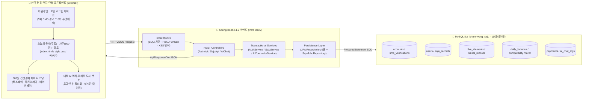
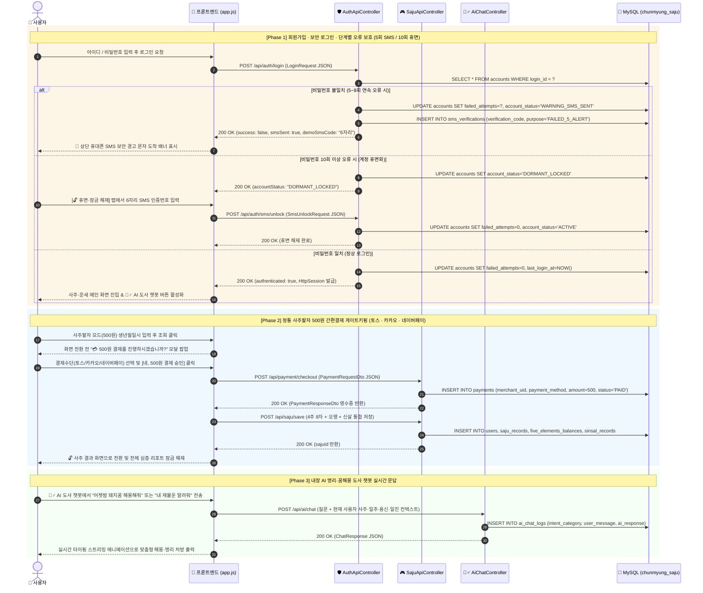
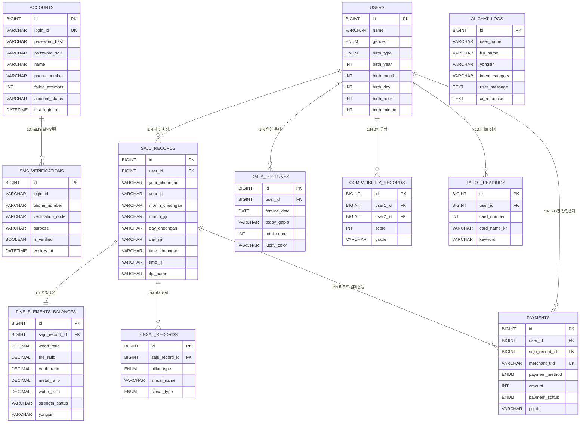

# 🌟 천명(天命) - 한국 정통 사주 만세력 · 오늘의 운세 · 타로 · AI 명리/꿈해몽 풀스택 웹 서비스

> **한국천문연구원(KASI) 24절기 역법 기반 만세력 엔진 + 내장형 AI 명리·꿈해몽 도사 챗봇 + 보안 로그인(PBKDF2·SQL 인젝션 방어·SMS 휴면해제) + 500원 간편결제(토스·카카오·네이버페이) + Spring Boot 4.x & MySQL 8.x (JPA / JDBC) 연동 프로젝트**


---

## 📑 목차

1. [프로젝트 개요](#-1-프로젝트-개요)
2. [기술 스택 (Tech Stack)](#-2-기술-스택-tech-stack)
3. [핵심 구현 아키텍처 및 세부 구현 방법](#-3-핵심-구현-아키텍처-및-세부-구현-방법)
4. [요청-응답 처리 시퀀스 다이어그램](#-4-요청-응답-처리-시퀀스-다이어그램)
5. [데이터베이스 ERD 및 11대 정규화 엔티티 명세](#-5-데이터베이스-erd-및-11대-정규화-엔티티-명세)
6. [API별 상세 요청(Request) & 응답(Response) 명세](#-6-api별-상세-요청request--응답response-명세)
7. [프로젝트 디렉토리 구조](#-7-프로젝트-디렉토리-구조)
8. [IntelliJ IDEA & MySQL JDBC 연동 가이드](#-8-intellij-idea--mysql-jdbc-연동-가이드)
9. [로컬 빌드 및 실행 방법](#-9-로컬-빌드-및-실행-방법)

---

## 📖 1. 프로젝트 개요

**천명(天命) 欽定萬歲曆**은 조선 왕실 규장각 만세력 고서(古書)와 궁중 단청(丹靑)·오방색(五方色) 전통 미학을 현대 웹으로 재해석한 **정통 사주팔자 · 오늘의 운세 · 3-Card 타로 · 내장 AI 명리/꿈해몽 도사 챗봇 풀스택 웹 서비스**입니다.

단순 정적 페이지나 파일 저장 방식이 아니라 **Spring Boot 4.1.2 백엔드와 MySQL 8.x 데이터베이스를 Spring Data JPA 및 Spring JDBC(`JdbcTemplate`)로 연동**하여 회원 보안 계정, SMS 인증 이력, 사주 4주 8자 원장, 오행 밸런스, 8대 신살, 일일 운세, 2인 궁합, 타로 점괘, 500원 간편결제 원장, AI 상담 로그까지 **총 11개의 정규화 엔티티 테이블**로 세분화해 저장·관리합니다.

---

## 🛠 2. 기술 스택 (Tech Stack)

| 영역 | 기술 / 라이브러리 | 버전 | 적용 및 구현 역할 |
| :---: | :--- | :---: | :--- |
| **Language** | Java (OpenJDK) | `21 LTS` | 백엔드 비즈니스 로직, 보안 암호화, AI 명리·꿈해몽 추론 엔진 구현 |
| **Framework** | Spring Boot | `4.1.2` | 내장 Tomcat 웹 서버(`8085`), RESTful API, `HttpSession` 인증 관리 |
| **Database** | MySQL | `8.x` | `utf8mb4` 기반 11대 정규화 엔티티 테이블 영구 저장 및 트랜잭션 관리 |
| **ORM / JPA** | Spring Data JPA (Hibernate) | `7.4.x` | 엔티티 매핑, `@OneToOne`/`@OneToMany` 영속성 전이(`CascadeType.ALL`) |
| **JDBC** | Spring JDBC (`JdbcTemplate`) | `7.0.x` | `DataSource` 커넥션 메타데이터 진단, 다중 테이블 SQL JOIN 직접 쿼리 |
| **Security** | `PBKDF2WithHmacSHA256` & `SecurityUtils` | `Custom` | 16바이트 랜덤 Salt 해싱, SQL 인젝션 시그니처 차단, XSS 정화, SMS 휴면해제 |
| **Payment BM** | 토스페이 · 카카오페이 · 네이버페이 모달 | `500 KRW` | 오늘의 운세 무료 / 정통 사주 500원 결제 승인 후 화면 전환 게이트키핑 |
| **Built-in AI** | `AiCounselorService` (명리·꿈해몽 AI) | `Built-in` | 사주·일진·용신 실시간 컨텍스트 결합 1:1 상담 및 동양 정통 주공해몽(꿈해몽) |
| **Frontend** | HTML5 / Tailwind CSS / ES6+ | `Standard` | 한국 전통 단청·한지·창살·낙관 디자인, 실시간 천기 전광판, 타이핑 스트리밍 UI |
| **API Docs** | SpringDoc OpenAPI (Swagger) | `3.2.0` | `/swagger-ui.html` 기반 전체 REST API 명세 시각화 및 즉시 호출 테스트 |

---

## 🏗 3. 핵심 구현 아키텍처 및 세부 구현 방법

### 3-1. 전체 시스템 계층형 아키텍처 (Layered Architecture)



### 3-2. 6대 핵심 도메인별 세부 구현 내용

| 구분 | 담당 클래스 / 파일 | 세부 구현 메커니즘 및 핵심 로직 |
| :---: | :--- | :--- |
| **1. 회원가입 · 로그인 게이트 및 단계별 계정 보호** | `AuthApiController`<br/>`AuthService`<br/>`SecurityUtils` | • **초기 접속 게이트**: 비로그인 상태로 접속 시 사주 입력창과 AI 도사 챗봇을 숨기고 **로그인/회원가입 화면(`#authSection`)**을 먼저 띄웁니다.<br/>• **비밀번호 암호화**: 평문 저장 없이 계정별 16바이트 `SecureRandom` Salt + `PBKDF2WithHmacSHA256`(65,536회 반복) 단방향 해시와 상수 시간 비교(`verifyPassword`)를 적용했습니다.<br/>• **1~4회 오류 (5회 미만)**: `failed_attempts`를 증가시키고 남은 시도 횟수 경고 메시지를 반환합니다.<br/>• **5~9회 오류 (5회 이상)**: 계정 상태를 `WARNING_SMS_SENT`로 전환하고, 가입된 휴대폰 번호로 **6자리 본인확인 인증번호 문자(SMS)**를 발송(`sms_verifications` 테이블 저장 및 화면 상단 SMS 도착 배너 표출)합니다.<br/>• **10회 이상 오류**: 계정을 즉시 **`DORMANT_LOCKED`(휴면·잠금)** 처리하여 이후 비밀번호가 맞아도 로그인을 차단하고, **[🔓 휴면·잠금 해제]** 탭에서 휴대폰 SMS 인증번호 6자리를 검증해야만 `ACTIVE` 및 실패 횟수 `0`으로 초기화합니다. |
| **2. SQL 인젝션 2중 방어 및 웹 보안** | `SecurityUtils`<br/>`SajuJdbcRepository` | • **1차 방어 (`PreparedStatement`)**: 모든 JPA 및 `JdbcTemplate` 쿼리에서 문자열 결합을 배제하고 `?` 파라미터 바인딩만 사용합니다.<br/>• **2차 방어 (`validateNoSqlInjection`)**: `SELECT`, `UNION`, `DROP`, `DELETE`, `OR 1=1`, `--`, `/* */`, `;` 등 SQL 인젝션 공격 시그니처 정규식을 클라이언트와 서버 양단에서 검사하여 탐지 즉시 `400 Bad Request`로 차단합니다.<br/>• **XSS 방어 (`sanitizeXss`)**: `<`, `>`, `&`, `"`, `'` 특수문자를 이스케이프 처리합니다. |
| **3. 오늘의 운세 작동 메커니즘 (100% 무료)** | `fortune.js`<br/>`calendar.js`<br/>`saju.js` | • 상용 운세 플랫폼(포스텔러·점신)의 일진 알고리즘을 반영하여 **[사용자 본원 일간·일지·용신]**과 **[당일 60갑자 일진]**을 매칭합니다.<br/>• **① 십신(十神) 작용**, **② 12운성(十二運星: 장생·관대·건록·제왕 등 12단계 에너지 바이오리듬)**, **③ 천간합·지지육합·천간충·지지충 실시간 신호등 트리거**, **④ 시두법(時頭法) 4대 시간대별 흐름**, **⑤ 결핍 오행/용신 기반 개운 음식·컬러·하도 수리 숫자·방위**를 결정론적 알고리즘으로 산출합니다. |
| **4. 사주팔자 500원 유료화 게이트 & 3사 간편결제** | `SajuApiController`<br/>`SajuService`<br/>`PaymentEntity` | • **무료/유료 분리**: 오늘의 운세와 타로는 무료(`FREE`)로 즉시 열람되며, 정통 사주팔자는 **500원 유료(`500원`)** 서비스로 운영됩니다.<br/>• **결제 후 화면 전환 게이트키핑**: 사주팔자 모드에서 조회 버튼을 누르면 결과 화면으로 넘어가지 않고 입력 화면 위에서 **`"💳 500원 결제를 진행하시겠습니까?"`** 모달이 먼저 팝업됩니다. 결제 취소 시 입력 화면에 머무르며, **토스페이(`TOSS_PAY`) · 카카오페이(`KAKAO_PAY`) · 네이버페이(`NAVER_PAY`)** 중 하나를 선택해 최종 결제 승인(`POST /api/payment/checkout`)을 완료해야만 MySQL `payments` 테이블에 영수증(`ORD-YYYYMMDD-XXXXXX`)이 기록되면서 사주 결과 화면으로 전환됩니다. |
| **5. 내장형 AI 명리 · 꿈해몽 도사 챗봇** | `AiChatController`<br/>`AiCounselorService`<br/>`AiChatLogEntity` | • **로그인 후 전용 노출**: 로그인 전에는 챗봇 버튼과 드로어가 완전히 숨겨지며, 로그인 완료 후에만 우측 하단 플로팅 도사 버튼과 상단 헤더 버튼이 활성화됩니다.<br/>• **사주 컨텍스트 실시간 연동**: 사용자의 일주, 수호동물, 신강/신약, 용신, 오늘의 십신·12운성·점수를 실시간으로 결합하여 재물·연애·이직·오늘의 비책·용신 개운법을 1:1로 상담합니다.<br/>• **동양 정통 꿈해몽(周公解夢)**: 돼지·똥·황금(`대대길몽 98점`), 용·호랑이·태양(`제왕길몽 97점`), 활활 타는 불(`번창길몽 94점`), 죽음·시체·피(`역몽 대길조 93점`), 조상님(`음덕예지몽 92점`), 뱀·맑은 물·잉어(`지혜·재원 길몽 90점`), 치아 빠짐·쫓기는 꿈(`신중경고몽·심몽`)을 내 사주 일진과 대조해 해몽하고 MySQL `ai_chat_logs` 테이블에 저장합니다. |
| **6. 한국 전통 단청·한지 디자인 & 타로 카테고리 재셔플** | `index.html`<br/>`style.css`<br/>`app.js` | • **한국 전통 미학**: 궁중 단청 5색 상·하단 띠(`.dancheong-bar`), 조선 왕실 규장각 현판 헤더, 사괘(`☰ ☲ ☵ ☷`) 및 오방색(`靑·赤·黃·白·黑`) 장식, 한지 고서 이중 창살 테두리, 주칠 낙관 인장(`天命`, `四柱命式`), 실시간 천기 마퀴 전광판을 적용했습니다.<br/>• **타로 카테고리 전환 재셔플**: 타로에서 카테고리(`연애`, `진로`, `금전`, `치유`)를 바꾸면 이전 선택 카드를 재사용하지 않고 `resetTarotSpread()`를 호출해 12장 덱을 즉시 새로 셔플하고 3장을 다시 뽑게 합니다. |

---

## 🔄 4. 요청-응답 처리 시퀀스 다이어그램



---

## 🗄 5. 데이터베이스 ERD 및 11대 정규화 엔티티 명세

### 5-1. MySQL 데이터베이스 ERD (`chunmyung_saju`)



### 5-2. 11대 엔티티 클래스 및 테이블 매핑 요약

> 패키지 경로: `com.chunmyung.saju.entity`

| No. | 엔티티 클래스 | DB 테이블명 | 연관 관계 | 핵심 저장 항목 |
| :-: | :--- | :--- | :---: | :--- |
| **1** | `AccountEntity` | `accounts` | `1 : N` (Auth) | 로그인 ID, PBKDF2 해시·Salt, 휴대폰 번호, 실패 횟수, 휴면 상태 |
| **2** | `SmsVerificationEntity` | `sms_verifications` | `N : 1` (`accounts`) | 수신 휴대폰 번호, 6자리 인증번호, 발송 목적, 만료 일시, 인증 여부 |
| **3** | `UserEntity` | `users` | `1 : N` (Root) | 이름, 성별, 생년월일시, 양·음력·윤달, 30분 시차보정 여부 |
| **4** | `SajuRecordEntity` | `saju_records` | `N : 1` (`users`) | 4주 8자(천간·지지), 본원 일간, 60갑자 일주명, 수호동물, 일주론 |
| **5** | `FiveElementsEntity` | `five_elements_balances` | `1 : 1` (`saju_records`) | 5오행 비율(%), 과다·결핍 오행, 신강·신약 판정, 추천 용신 |
| **6** | `SinsalEntity` | `sinsal_records` | `N : 1` (`saju_records`) | 기둥별 8대 신살(천을귀인·도화살·역마살 등), 길흉 구분 및 해설 |
| **7** | `DailyFortuneEntity` | `daily_fortunes` | `N : 1` (`users`) | 운세 날짜, 일진 간지, 5대 운세 점수, 행운의 색·숫자·방위·총평 |
| **8** | `CompatibilityEntity` | `compatibility_records` | `N : 2` (`users`) | 본인·상대방 궁합 점수, 등급, 천간·지지 합충 분석 및 조언 |
| **9** | `TarotEntity` | `tarot_readings` | `N : 1` (`users`) | 타로 카드 번호(0~21), 한글·영문 카드명, 정·역방향, 키워드·해석 |
| **10** | `PaymentEntity` | `payments` | `N : 1` (`users`) | 주문번호(`ORD-...`), 토스·카카오·네이버페이 수단, 500원, 승인번호 |
| **11** | `AiChatLogEntity` | `ai_chat_logs` | `Independent` | 사용자명, 연동 일주·용신, 질문 의도(`DREAM` 등), 질문 및 AI 답변 |

---

## 📡 6. API별 상세 요청(Request) & 응답(Response) 명세

모든 REST API 응답은 아래 `ApiResponseDto<T>` 공통 포맷으로 반환됩니다.

| 응답 필드명 | 데이터 타입 | 설명 |
| :---: | :---: | :--- |
| `success` | `boolean` | 요청 처리 성공 여부 (`true` / `false`) |
| `message` | `String` | 처리 결과 또는 단계별 보안 경고 안내 메시지 |
| `data` | `T` (Generic) | 실제 반환 데이터 객체 (인증 상태, 영수증, AI 답변, 저장된 PK ID 등) |

---

### ① 회원가입 API (`POST /api/auth/signup`)

| 항목 | 상세 내용 |
| :---: | :--- |
| **HTTP Method & URI** | `POST /api/auth/signup` |
| **담당 메서드** | `AuthApiController.signup()` ➔ `AuthService.registerAccount()` |
| **구현 동작** | 입력값 SQL 인젝션 검사를 수행한 후, 16바이트 랜덤 Salt와 `PBKDF2WithHmacSHA256`으로 비밀번호를 단방향 암호화하여 `accounts` 테이블에 저장하고 로그인 세션을 발급합니다. |

#### 📥 요청 예시 (Request Body JSON)
```json
{
  "loginId": "hong1234",
  "password": "mySecretPassword!",
  "name": "홍길동",
  "phoneNumber": "010-1234-5678",
  "gender": "M",
  "birthYear": 1995,
  "birthMonth": 5,
  "birthDay": 15
}
```

#### 📤 응답 예시 (Response - 200 OK)
```json
{
  "success": true,
  "message": "홍길동 님, 천명(天命) 회원가입이 완료되었습니다!",
  "data": {
    "authenticated": true,
    "accountId": 1,
    "loginId": "hong1234",
    "name": "홍길동",
    "maskedPhone": "010-****-5678",
    "gender": "M",
    "birthYear": 1995,
    "birthMonth": 5,
    "birthDay": 15,
    "failedAttempts": 0,
    "accountStatus": "ACTIVE",
    "smsSent": false,
    "smsPreviewMessage": null,
    "demoSmsCode": null
  }
}
```

---

### ② 보안 로그인 API (`POST /api/auth/login`) — 5회 오류 SMS 발송 & 10회 휴면화

| 항목 | 상세 내용 |
| :---: | :--- |
| **HTTP Method & URI** | `POST /api/auth/login` |
| **담당 메서드** | `AuthApiController.login()` ➔ `AuthService.loginAccount()` |
| **구현 동작** | • **1~4회 실패**: 실패 횟수 증가 및 경고 메시지 반환<br/>• **5~9회 실패**: `account_status = 'WARNING_SMS_SENT'` 전환 및 등록된 휴대폰으로 6자리 본인확인 SMS 문자 자동 발송 (`sms_verifications` 저장)<br/>• **10회 이상 실패**: `account_status = 'DORMANT_LOCKED'`(계정 휴면화) 전환 및 로그인 전면 차단 |

#### 📥 요청 예시 (Request Body JSON)
```json
{
  "loginId": "hong1234",
  "password": "wrongPassword"
}
```

#### 📤 응답 예시 A (1~4회 비밀번호 오류 시 경고)
```json
{
  "success": false,
  "message": "⚠️ 비밀번호가 일치하지 않습니다. (현재 3회 실패 / 5회 이상 오류 시 휴대폰 문자 발송, 10회 이상 오류 시 계정 휴면화)",
  "data": {
    "authenticated": false,
    "accountId": 1,
    "loginId": "hong1234",
    "name": "홍길동",
    "maskedPhone": "010-****-5678",
    "failedAttempts": 3,
    "accountStatus": "ACTIVE",
    "smsSent": false
  }
}
```

#### 📤 응답 예시 B (5회 이상 비밀번호 오류 시 — 휴대폰 SMS 문자 즉시 발송)
```json
{
  "success": false,
  "message": "🚨 비밀번호 5회 연속 오류! 등록된 휴대폰(010-****-5678)으로 보안 경고 문자가 발송되었습니다. (10회 이상 실패 시 계정이 휴면화됩니다. 남은 기회: 5회)",
  "data": {
    "authenticated": false,
    "accountId": 1,
    "loginId": "hong1234",
    "name": "홍길동",
    "maskedPhone": "010-****-5678",
    "failedAttempts": 5,
    "accountStatus": "WARNING_SMS_SENT",
    "smsSent": true,
    "smsPreviewMessage": "[천명(天命) 보안경고] 비밀번호 5회 연속 오류 감지! 본인확인 인증번호는 [482915] 입니다. (10회 오류 시 계정 휴면화)",
    "demoSmsCode": "482915"
  }
}
```

#### 📤 응답 예시 C (10회 이상 비밀번호 오류 시 — 계정 휴면화 잠금)
```json
{
  "success": false,
  "message": "🔒 비밀번호를 10회 이상 잘못 입력하여 계정이 휴면화(잠금)되었습니다! 휴대폰(010-****-5678)으로 발송된 SMS 인증번호를 입력해야 잠금이 해제됩니다.",
  "data": {
    "authenticated": false,
    "accountId": 1,
    "loginId": "hong1234",
    "name": "홍길동",
    "maskedPhone": "010-****-5678",
    "failedAttempts": 10,
    "accountStatus": "DORMANT_LOCKED",
    "smsSent": true,
    "smsPreviewMessage": "[천명(天命) 긴급보안] 비밀번호 10회 연속 오류로 계정이 휴면화(잠금) 처리되었습니다. 해제 인증번호는 [739104] 입니다.",
    "demoSmsCode": "739104"
  }
}
```

---

### ③ 휴대폰 SMS 인증번호 검증 및 휴면 계정 해제 API (`POST /api/auth/sms/unlock`)

| 항목 | 상세 내용 |
| :---: | :--- |
| **HTTP Method & URI** | `POST /api/auth/sms/unlock` |
| **담당 메서드** | `AuthApiController.unlockWithSms()` ➔ `AuthService.unlockAccountWithSms()` |
| **구현 동작** | 아이디, 휴대폰 번호, 6자리 SMS 인증번호(유효시간 5분)를 검증하여 일치하면 `account_status = 'ACTIVE'`, `failed_attempts = 0`으로 초기화하고, 새 비밀번호 입력 시 새 Salt+해시로 변경합니다. |

#### 📥 요청 예시 (Request Body JSON)
```json
{
  "loginId": "hong1234",
  "phoneNumber": "010-1234-5678",
  "verificationCode": "739104",
  "newPassword": "newSafePassword123!"
}
```

#### 📤 응답 예시 (Response - 200 OK)
```json
{
  "success": true,
  "message": "✅ 휴대폰 SMS 인증이 완료되어 계정 휴면(잠금) 및 오류 횟수가 모두 초기화되었습니다! 이제 로그인하실 수 있습니다.",
  "data": {
    "authenticated": false,
    "accountId": 1,
    "loginId": "hong1234",
    "name": "홍길동",
    "maskedPhone": "010-****-5678",
    "failedAttempts": 0,
    "accountStatus": "ACTIVE",
    "smsSent": false
  }
}
```

---

### ④ 유료 사주 500원 간편결제 승인 API (`POST /api/payment/checkout`)

| 항목 | 상세 내용 |
| :---: | :--- |
| **HTTP Method & URI** | `POST /api/payment/checkout` |
| **결제 수단 코드** | `TOSS_PAY` (토스페이), `KAKAO_PAY` (카카오페이), `NAVER_PAY` (네이버페이) |
| **구현 동작** | 사주팔자 모드(500원)에서 사용자가 선택한 간편결제 수단으로 500원 결제를 승인하고, 고유 주문번호(`ORD-YYYYMMDD-XXXXXX`)와 PG 승인번호를 발급하여 MySQL `payments` 테이블에 저장합니다. |

#### 📥 요청 예시 (Request Body JSON)
```json
{
  "name": "홍길동",
  "gender": "M",
  "birthYear": 1995,
  "birthMonth": 5,
  "birthDay": 15,
  "sajuRecordId": 1,
  "productType": "SAJU_FULL_REPORT",
  "productName": "천명(天命) 정통 사주팔자 · 대운 · 심층 리포트 열람권",
  "paymentMethod": "TOSS_PAY",
  "amount": 500
}
```

#### 📤 응답 예시 (Response - 200 OK)
```json
{
  "success": true,
  "message": "토스페이 500원 결제가 완료되었습니다. (주문번호: ORD-20261120-841920)",
  "data": {
    "paymentId": 1,
    "userId": 1,
    "userName": "홍길동",
    "merchantUid": "ORD-20261120-841920",
    "productType": "SAJU_FULL_REPORT",
    "productName": "천명(天命) 정통 사주팔자 · 대운 · 심층 리포트 열람권",
    "paymentMethod": "TOSS_PAY",
    "paymentMethodKr": "토스페이",
    "amount": 500,
    "paymentStatus": "PAID",
    "pgTid": "TOSS_TID_1795180841920",
    "paidAt": "2026-11-20T22:15:30"
  }
}
```

---

### ⑤ 내장형 AI 명리 · 꿈해몽 도사 챗봇 문답 API (`POST /api/ai/chat`)

| 항목 | 상세 내용 |
| :---: | :--- |
| **HTTP Method & URI** | `POST /api/ai/chat` |
| **담당 메서드** | `AiChatController.chat()` ➔ `AiCounselorService.generateCounselReply()` |
| **구현 동작** | 사용자의 질문 의도(`DREAM_INTERPRETATION`, `WEALTH`, `LOVE`, `CAREER`, `TODAY`, `ELEMENT_YONGSIN`, `SINSAL_DAEUN`)를 분류하고, 연동된 사용자의 일주·용신·십신·12운성 컨텍스트와 결합해 맞춤형 명리 상담 및 동양 정통 꿈해몽 답변을 생성한 뒤 MySQL `ai_chat_logs` 테이블에 저장합니다. |

#### 📥 요청 예시 (Request Body JSON — 꿈해몽 질문 시)
```json
{
  "message": "어젯밤 꿈에 돼지와 황금을 본 꿈을 꿨는데 해몽해줘!",
  "userName": "홍길동",
  "gender": "M",
  "iljuName": "병인(丙寅)",
  "dayMaster": "丙",
  "zodiacAnimal": "붉은 호랑이",
  "strengthStatus": "신강(身强)",
  "yongsin": "금(金) / 수(水)",
  "deficientElement": "수(水)",
  "todayTenGod": "식신(食神)",
  "todayTwelveStage": "건록(建祿)",
  "todayScore": 88,
  "luckyColor": "순백의 화이트, 실버",
  "luckyFood": "정갈한 생선구이, 배 도라지차",
  "luckyDirection": "서쪽 (West)",
  "sinsalNames": "천을귀인·홍염살"
}
```

#### 📤 응답 예시 (Response - 200 OK)
```json
{
  "success": true,
  "message": "AI 명리 도사 응답이 생성되었습니다.",
  "data": {
    "chatLogId": 1,
    "intentCategory": "DREAM_INTERPRETATION",
    "intentBadge": "🌙 동양 정통 꿈해몽(夢兆) 처방",
    "reply": "🌙 **홍길동** 님의 꿈자리와 사주 일진을 대조하여 해몽해 드립니다.\n\n• **[해몽 판정]**: **🌟 대대길몽(大大吉夢) — 재물·횡재 지수 98점**\n• **[동양 해몽 원전 풀이]**: 동양 해몽에서 **돼지·황금·대변(똥)**은 오행상 비옥한 **토(土)와 금(金)의 결실**을 뜻하는 최고 으뜸의 재물 길몽입니다...\n• **[사주·일진 결합 행동 지침]**: 오늘 귀하의 일진(**식신(食神) · 건록(建祿)**)과 맞물려 재물복이 크게 열려 있으니...",
    "followUpTip": "💡 다른 꿈도 해몽해 드립니다! 예: '돼지꿈 꿨어', '불이 활활 타는 꿈 해몽해줘', '뱀이 나오는 꿈', '이빨 빠지는 꿈' 등 구체적으로 적어보세요."
  }
}
```

---

### ⑥ 사주팔자 4주 8자 · 오행 · 신살 통합 저장 API (`POST /api/saju/save`)

| 구분 | 필드명 | 타입 | 필수 | 설명 |
| :-: | :--- | :---: | :-: | :--- |
| **사용자** | `name`, `gender`, `birthType` | `String` | Y | 이름, 성별(`"M"`/`"F"`), 역법(`"SOLAR"`/`"LUNAR"`) |
| **사용자** | `birthYear`, `birthMonth`, `birthDay` | `Integer` | Y | 출생 연·월·일 |
| **사용자** | `birthHour`, `birthMinute` | `Integer` | N | 출생 시·분 (시간 모름일 경우 `null`) |
| **사주원장** | `yearCheongan` ~ `timeJiji` | `String` | Y | 년·월·일·시주 천간(天干) 및 지지(地支) 8글자 |
| **사주원장** | `dayMaster`, `iljuName`, `zodiacAnimal` | `String` | Y | 본원 일간, 60갑자 일주명, 수호동물 |
| **오행밸런스** | `woodRatio` ~ `waterRatio` | `BigDecimal` | Y | 목·화·토·금·수 오행 비율 (`0.00` ~ `100.00`) |
| **오행밸런스** | `strengthStatus`, `yongsin` | `String` | Y | 신강·신약 판정 및 추천 용신 |
| **신살목록** | `sinsals` | `List<SinsalDto>` | N | 기둥(`pillarType`), 신살명(`sinsalName`), 길흉, 해설 배열 |

---

### ⑦ 기타 조회 및 저장 엔드포인트 요약

| HTTP Method | Endpoint | 설명 | 사용 기술 |
| :---: | :--- | :--- | :--- |
| `GET` | `/api/auth/check-id?loginId=...` | 회원가입 아이디 중복 여부 및 SQL 인젝션 안전성 검사 | `Spring Data JPA` |
| `POST` | `/api/auth/sms/send` | 휴면·잠금 해제용 6자리 휴대폰 SMS 인증번호 발송 | `Spring Data JPA` |
| `GET` | `/api/auth/me` | 현재 브라우저 `HttpSession` 로그인 세션 상태 확인 | `HttpSession` |
| `POST` | `/api/auth/logout` | 세션 무효화 및 로그아웃 처리 | `HttpSession` |
| `POST` | `/api/fortune/save` | 오늘의 일일 운세 점수 및 행운 아이템 Upsert 저장 | `Spring Data JPA` |
| `POST` | `/api/compatibility/save` | 2인 사주 궁합 점수 및 천간·지지 합충 결과 저장 | `Spring Data JPA` |
| `POST` | `/api/tarot/save` | 3-Card 타로 점괘 결과 저장 | `Spring Data JPA` |
| `GET` | `/api/payment/history?limit=10` | `payments` + `users` + `saju_records` JOIN 최근 500원 결제 내역 조회 | `Spring JDBC (JdbcTemplate)` |
| `GET` | `/api/history/recent?limit=10` | `saju_records` + `users` + `five_elements_balances` 3중 JOIN 조회 | `Spring JDBC (JdbcTemplate)` |
| `GET` | `/api/jdbc/check` | MySQL JDBC 커넥션 및 드라이버 메타데이터 상태 진단 | `DataSource` / `JDBC` |

---

## 🗂 7. 프로젝트 디렉토리 구조

```text
Daily Fortune/
├── pom.xml
├── mvnw
├── mvnw.cmd
└── src/
    └── main/
        ├── java/com/chunmyung/saju/
        │   ├── SajuApplication.java
        │   ├── config/
        │   │   └── WebConfig.java
        │   ├── security/
        │   │   └── SecurityUtils.java
        │   ├── controller/
        │   │   ├── AuthApiController.java
        │   │   ├── SajuApiController.java
        │   │   └── AiChatController.java
        │   ├── service/
        │   │   ├── AuthService.java
        │   │   ├── SajuService.java
        │   │   └── AiCounselorService.java
        │   ├── repository/
        │   │   ├── AccountRepository.java
        │   │   ├── SmsVerificationRepository.java
        │   │   ├── UserRepository.java
        │   │   ├── SajuRecordRepository.java
        │   │   ├── DailyFortuneRepository.java
        │   │   ├── CompatibilityRepository.java
        │   │   ├── TarotRepository.java
        │   │   ├── PaymentRepository.java
        │   │   ├── AiChatLogRepository.java
        │   │   └── SajuJdbcRepository.java
        │   ├── entity/
        │   │   ├── AccountEntity.java
        │   │   ├── SmsVerificationEntity.java
        │   │   ├── UserEntity.java
        │   │   ├── SajuRecordEntity.java
        │   │   ├── FiveElementsEntity.java
        │   │   ├── SinsalEntity.java
        │   │   ├── DailyFortuneEntity.java
        │   │   ├── CompatibilityEntity.java
        │   │   ├── TarotEntity.java
        │   │   ├── PaymentEntity.java
        │   │   └── AiChatLogEntity.java
        │   └── dto/
        │       ├── ApiResponseDto.java
        │       ├── AuthDtos.java
        │       ├── AiChatDtos.java
        │       ├── PaymentRequestDto.java
        │       ├── PaymentResponseDto.java
        │       ├── SajuSaveRequestDto.java
        │       ├── DailyFortuneSaveRequestDto.java
        │       ├── CompatibilitySaveRequestDto.java
        │       └── TarotSaveRequestDto.java
        └── resources/
            ├── application.yml
            ├── schema.sql
            └── static/
                ├── index.html
                ├── css/
                │   └── style.css
                └── js/
                    ├── app.js
                    ├── data/
                    │   ├── gapja60.js
                    │   ├── sinsal.js
                    │   └── tarot.js
                    └── engine/
                        ├── calendar.js
                        ├── saju.js
                        └── fortune.js
```

---

## 💻 8. IntelliJ IDEA & MySQL JDBC 연동 가이드

| 단계 | 설정 항목 | 설정 값 및 실행 방법 |
| :-: | :--- | :--- |
| **Step 1** | **프로젝트 열기** | IntelliJ IDEA 실행 ➔ `Open` ➔ `Daily Fortune` 폴더 선택 ➔ `Load Maven Project` 클릭 |
| **Step 2** | **Java SDK 설정** | `File` ➔ `Project Structure` (`Cmd + ;`) ➔ **Project SDK: Java 21** 선택 |
| **Step 3** | **Database 탭 연결** | 우측 `Database` 탭 ➔ `+` ➔ `Data Source` ➔ **MySQL** 클릭 |
| **Step 4** | **JDBC 접속 정보** | **Host**: `localhost` · **Port**: `3306` · **Database**: `chunmyung_saju` · **User**: `root` |
| **Step 5** | **커넥션 테스트** | `Test Connection` 클릭 ➔ `Succeeded` 확인 후 `OK` 클릭 |

---

## 🚀 9. 로컬 빌드 및 실행 방법

### 1. MySQL 스키마 초기화
```bash
mysql -u root -p -e "CREATE DATABASE IF NOT EXISTS chunmyung_saju CHARACTER SET utf8mb4 COLLATE utf8mb4_unicode_ci;"
mysql -u root -p chunmyung_saju < src/main/resources/schema.sql
```

### 2. Spring Boot 서버 구동
```bash
./mvnw spring-boot:run
```

### 3. 주요 접속 URL

| 서비스 항목 | 접속 주소 (URL) | 비고 |
| :--- | :--- | :--- |
| **천명(天命) 메인 웹 서비스** | `http://localhost:8085/` | 최초 접속 시 로그인/회원가입 게이트 노출 |
| **Swagger OpenAPI 문서** | `http://localhost:8085/swagger-ui.html` | 전체 API 명세 조회 및 즉시 호출 테스트 |
| **JDBC 연결 진단 API** | `http://localhost:8085/api/jdbc/check` | MySQL JDBC 커넥션 상태 확인 |
| **최근 500원 결제 내역 조회 API** | `http://localhost:8085/api/payment/history` | 토스·카카오·네이버페이 결제 원장 조회 |
| **최근 AI 도사 상담 로그 조회 API** | `http://localhost:8085/api/ai/history` | 사주 상담 및 꿈해몽 문답 이력 조회 |
