# 🌟 천명(天命) : 3D 가상 사찰 메타버스 & 한국 정통 사주 만세력 · 오늘의 운세 · AI 도사 풀스택 웹 플랫폼

> **한국천문연구원(KASI) 24절기 역법 만세력 엔진 + Three.js 기반 3D 대형 산사(절) 은하수 연등 광장 메타버스 + 내장형 AI 명리·꿈해몽 도사 챗봇 + 3중 보안 게이트(PBKDF2·SQLi Guard·SMS) + 500원 간편결제(토스·카카오·네이버페이) + Spring Boot 4.1.2 & MySQL 8.x (JPA / JDBC) 엔터프라이즈 프로젝트**


[](https://chunmyung-saju-demo.onrender.com)

> **🌐 실시간 라이브 데모 체험하기**: **[https://chunmyung-saju-demo.onrender.com](https://chunmyung-saju-demo.onrender.com)**  
> *(공개 데모 버전은 회원가입·로그인 및 500원 결제 단계 없이 바로 사주·타로·AI 도사·3D 연등광장을 체험할 수 있습니다. Render 무료 플랜 특성상 첫 접속 시 서버 기동에 20~30초가 소요될 수 있습니다.)*

---

## 📑 목차 (Table of Contents)

1. [📌 프로젝트 개요 및 기획 배경 (Project Overview)](#1-📌-프로젝트-개요-및-기획-배경-project-overview)
2. [🎬 서비스 시연 데모 영상 및 12대 핵심 워크플로우 (Live Demo & 12-Step Walkthrough)](#2-🎬-서비스-시연-데모-영상-및-12대-핵심-워크플로우-live-demo--12-step-walkthrough)
3. [🏮 천명 3D 산사(절) 은하수 소원 연등 광장 메타버스 (Three.js WebGL 3D Virtual Temple)](#3-🏮-천명-3d-산사절-은하수-소원-연등-광장-메타버스-threejs-webgl-3d-virtual-temple)
4. [👑 시스템 최고 관리자 계정 및 보안 관제실 (System Security & Administration)](#4-👑-시스템-최고-관리자-계정-및-보안-관제실-system-security--administration)
5. [📥 카테고리별 인터랙티브 서책 자료 내보내기 (PDF 대체 독립형 뷰어)](#5-📥-카테고리별-인터랙티브-서책-자료-내보내기-pdf-대체-독립형-뷰어)
6. [🔮 마음 치유 & 앞날 설계 부가 서비스 (동양 정통 꿈해몽 · 오늘의 마음 날씨)](#6-🔮-마음-치유--앞날-설계-부가-서비스-daily-wellness--guidance)
7. [🛠 기술 스택 및 라이브러리 명세 (Tech Stack)](#7-🛠-기술-스택-및-라이브러리-명세-tech-stack)
8. [🏗 핵심 아키텍처 및 도메인별 세부 구현 메커니즘 (System Architecture)](#8-🏗-핵심-아키텍처-및-도메인별-세부-구현-메커니즘-system-architecture)
9. [🔄 요청-응답 처리 시퀀스 다이어그램 (4-Phase Flow)](#9-🔄-요청-응답-처리-시퀀스-다이어그램-4-phase-flow)
10. [🗄 데이터베이스 ERD 및 11대 정규화 엔티티 설계 (Database ERD & Entity Specifications)](#10-🗄-데이터베이스-erd-및-11대-정규화-엔티티-설계-database-erd--entity-specifications)
11. [📡 RESTful API 상세 명세 (API Specifications & Examples)](#11-📡-restful-api-상세-명세-api-specifications--examples)
12. [📁 프로젝트 디렉토리 구조 (Directory Tree)](#12-📁-프로젝트-디렉토리-구조-directory-tree)
13. [💻 개발 환경 설정 및 MySQL 연동 가이드 (Environment Setup)](#13-💻-개발-환경-설정-및-mysql-연동-가이드-environment-setup)
14. [🚀 로컬 빌드 및 실행 가이드 (Build & Run Guide)](#14-🚀-로컬-빌드-및-실행-가이드-build--run-guide)

---

## 1. 📌 프로젝트 개요 및 기획 배경 (Project Overview)

**천명(天命) 欽定萬歲曆**은 조선 왕실 규장각 만세력 고서(古書)와 궁중 단청(丹靑)·오방색(五方色) 전통 미학을 현대 웹 기술로 재해석한 **풀스택 3D 가상 사찰 메타버스 & 정통 사주명리 힐링 플랫폼**입니다.

사용자의 생년월일시를 기반으로 인생의 앞날을 분석하는 데 그치지 않고, 하루의 마음을 위로하고 지친 일상에 평온과 서원을 품을 수 있는 **입체적 가상 사찰 메타버스 공간(천명전 연등 광장)**을 결합하여 전통 명리학과 현대 웹 기술(Three.js WebGL)의 시너지를 극대화하였습니다.

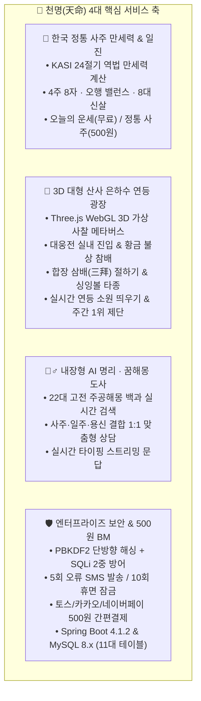

### 🌟 프로젝트 핵심 가치 및 특징
1. **정통 명리학 역법의 엄밀한 디지털화**: 한국천문연구원(KASI) 24절기 기준 시두법(時頭法)과 30분 동경시 차이 보정 로직을 탑재하여 분 단위의 정밀한 4주 8자와 10년 대운을 산출합니다.
2. **Three.js WebGL 3D 가상 사찰 메타버스**: 2D 웹 화면의 한계를 넘어, 밤하늘 은하수와 별똥별이 흐르는 고즈넉한 대형 산사(절)를 3D로 구현하여 전각 내부 진입, 황금 석가모니불 참배, 합장 삼배 절하기, 소원 연등 띄우기 및 응원(추천) 시스템을 제공합니다.
3. **금융 수준의 보안 아키텍처**: 비밀번호 65,536회 PBKDF2 해싱, SQL 인젝션 클라이언트/서버 2중 차단, 5회 비밀번호 오류 시 휴대폰 SMS 보안 경고 문자 발송, 10회 오류 시 자동 휴면화(DORMANT_LOCKED) 및 SMS 6자리 인증 해제 메커니즘을 적용했습니다.
4. **마이크로 결제(500원) 비즈니스 모델**: 오늘의 운세와 타로는 무료로 개방하고, 정통 사주 원국과 대운 심층 리포트는 토스페이·카카오페이·네이버페이 500원 간편결제 승인 게이트를 통과해야 열람할 수 있도록 설계했습니다.
5. **엔터프라이즈급 데이터 거버넌스**: Spring Boot 4.1.2 및 MySQL 8.x 환경에서 JPA와 JDBC(`JdbcTemplate`)를 결합하여 11개의 정규화 엔티티 테이블로 데이터를 무결하게 관리합니다.

---

## 2. 🎬 서비스 시연 데모 영상 및 12대 핵심 워크플로우 (Live Demo & 12-Step Walkthrough)

> **자동 순환 재생 데모 영상 (`assets/demo.gif`, 12단계 풀 플로우)** 및 **[🎥 고화질 H.264 MP4 데모 영상 원본 (`assets/demo.mp4`)](assets/demo.mp4)**

<p align="center">
  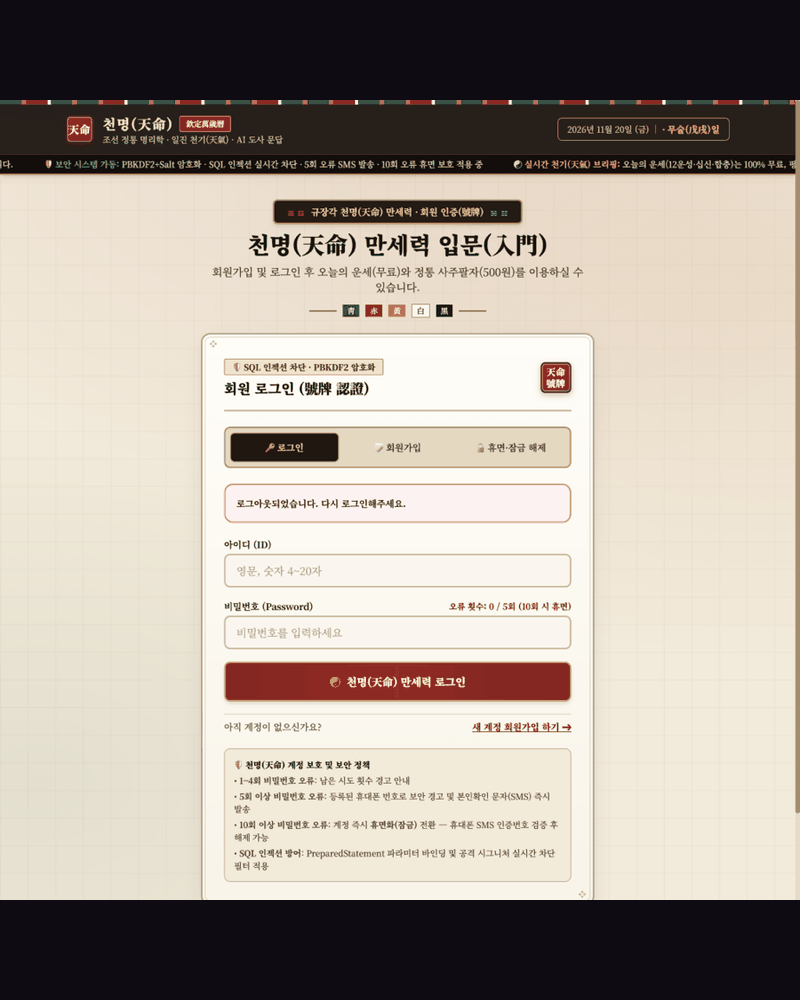
</p>

### 🖼️ 12대 단계별 핵심 플로우 및 기능 명세

| Step 1. 보안 로그인 · 회원가입 · SMS 휴면해제 | Step 2. 한국 전통 한지·단청 사주명식 입력 | Step 3. 500원 간편결제 게이트 (토스·카카오·네이버) |
| :---: | :---: | :---: |
| 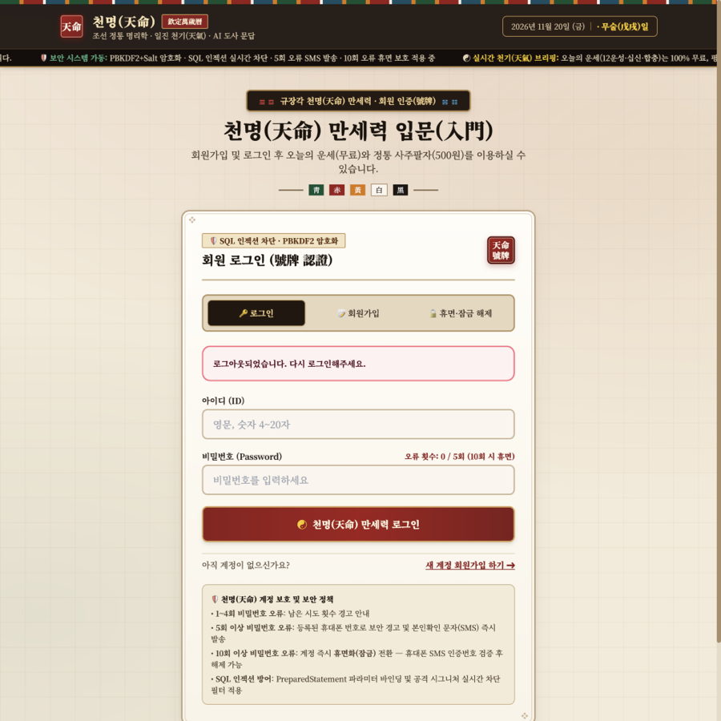<br/>• PBKDF2 단방향 암호화<br/>• 5회 오류 시 SMS 보안문자 발송<br/>• 10회 오류 시 계정 휴면화 및 SMS 인증 해제 | <br/>• 조선 왕실 규장각 한지·단청 미학<br/>• 양력/음력/윤달/시간모름 지원<br/>• 30분 동경시 시차 자동 보정 체크 | 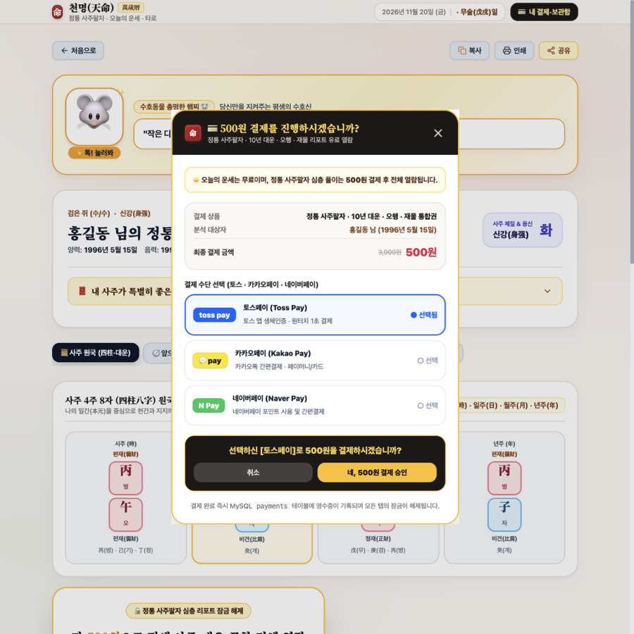<br/>• 오늘의 운세·타로는 100% 무료<br/>• 정통 사주팔자 500원 결제 게이트<br/>• 토스 · 카카오 · 네이버페이 지원 |
| **Step 4. 결제 완료 영수증 & 사주·대운 리포트** | **Step 5. 3-Card 타로 & 카테고리 전환 재셔플** | **Step 6. 내장 AI 명리 · 꿈해몽 도사 챗봇** |
| 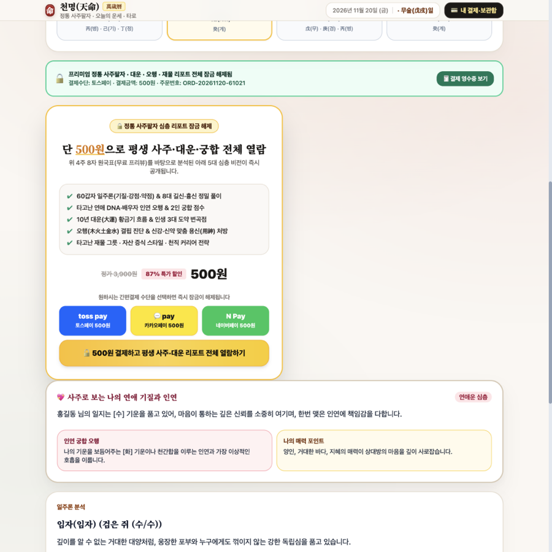<br/>• 결제 승인 후 영수증 즉시 발급<br/>• 4주 8자 만세력 & 10년 대운 표<br/>• 오행 밸런스 바 & 8대 신살 정밀 해설 | <br/>• 과거-현재-미래 3-Card 스프레드<br/>• 연애·금전·진로·치유 4대 분야<br/>• 카테고리 전환 시 12장 자동 재셔플 | 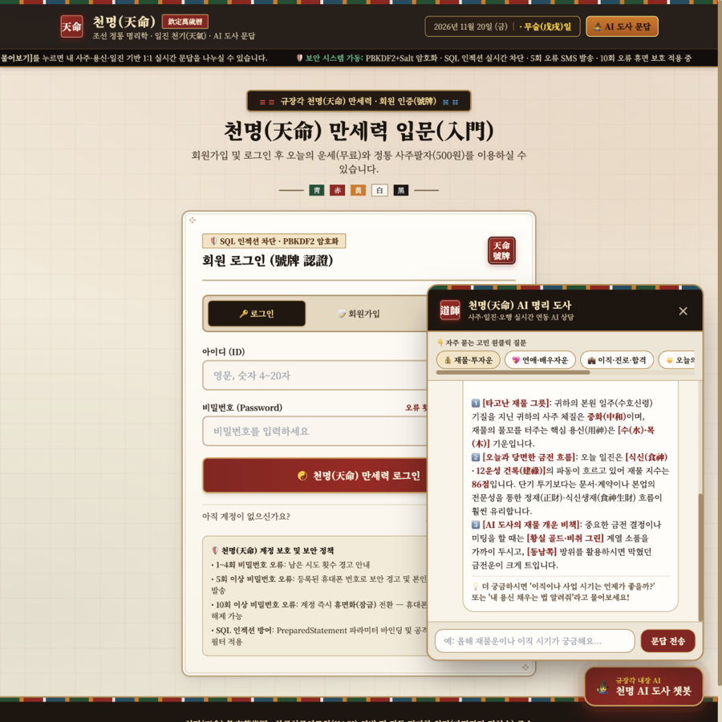<br/>• 로그인 후 전용 플로팅 도사 버튼<br/>• 내 사주·일주·용신 결합 1:1 상담<br/>• 22대 고전 주공해몽 즉시 판정 및 문답 |
| **Step 7. 공중 연등 · 5인 자율 NPC & 90도 상호 인사** | **Step 8. 대웅전 삼존불 · NPC 참배 절하기 & 소원판** | **Step 9. 현실적 4단계 합장 삼배(三拜) 애니메이션** |
| <br/>• 기둥-기둥 공중 로프 연등 & 열기구 5연발 폭죽<br/>• 최대 5인 자율 도반 NPC 무작위 산책<br/>• 도반끼리·플레이어와 서로 90도 인사 (`G`/클릭)<br/>• 소원 성취 축하 패널 이벤트 발생 시에만 노출 | 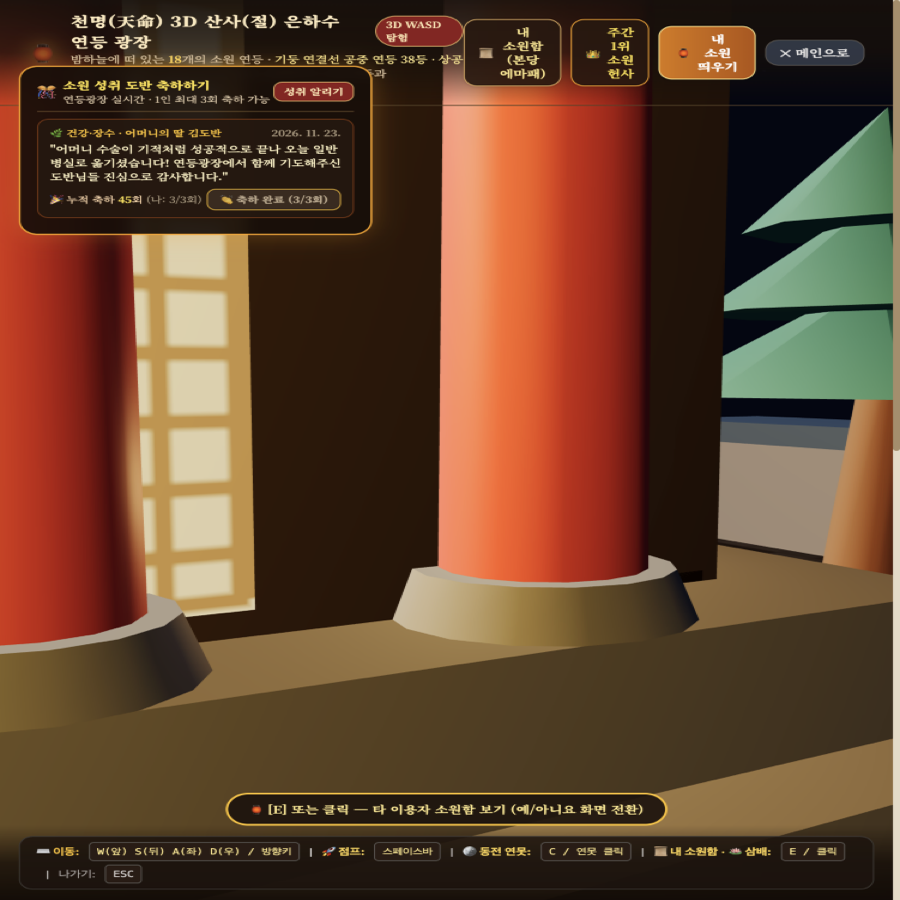<br/>• 본당 내부 2기 츠리도로 & 불단 앞 NPC 참배 절하기<br/>• 서쪽 벽 `📜 내 소원판(絵馬掛所)` 소원 적기·성취 알림<br/>• 동쪽 벽 `🏮 타 이용자 소원함` (`[예/아니요]` 열람)<br/>• 서브 모달 `[나가기]` 시 사주화면 아닌 연등광장 복귀 | 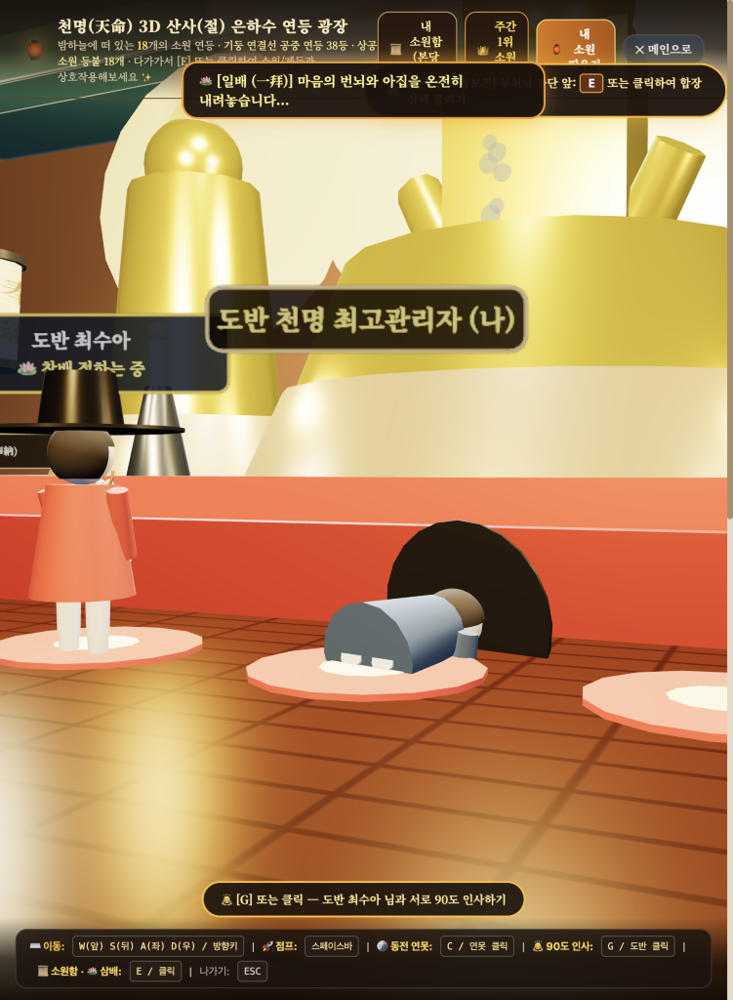<br/>• 불단 앞 연화문 방석에서 `[E]` 키/클릭<br/>• 합장➔무릎 꿇기(정강이 접기)➔82° 접족례➔기립 3회<br/>• 옆 방석 도반 NPC와 함께 참배하는 입체 연출<br/>• Web Audio API 싱잉볼 타종 & 3배 축원 모달 |
| **Step 10. ESC 키 & 안전 퇴장 확인 모달** | **Step 11. 타 이용자 소원함 8개 단위(`offset`) 출력** | **Step 12. 11단 대석계단 & 홍예교 무침하 정밀 물리** |
| 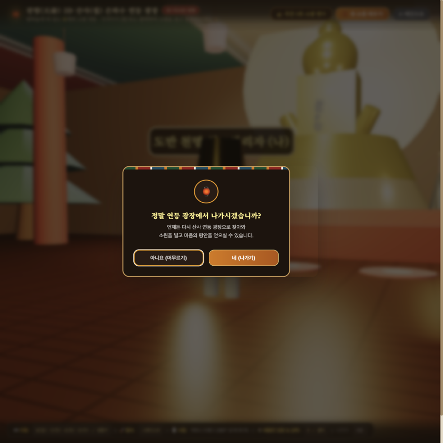<br/>• ESC 키 또는 [✕ 메인으로] 클릭 시 호출<br/>• 실수로 닫히지 않는 안전 모달 구조<br/>• [아니오 (머무르기)] ➔ 광장 유지<br/>• [네 (나가기)] ➔ 안전하게 메인 복귀 | 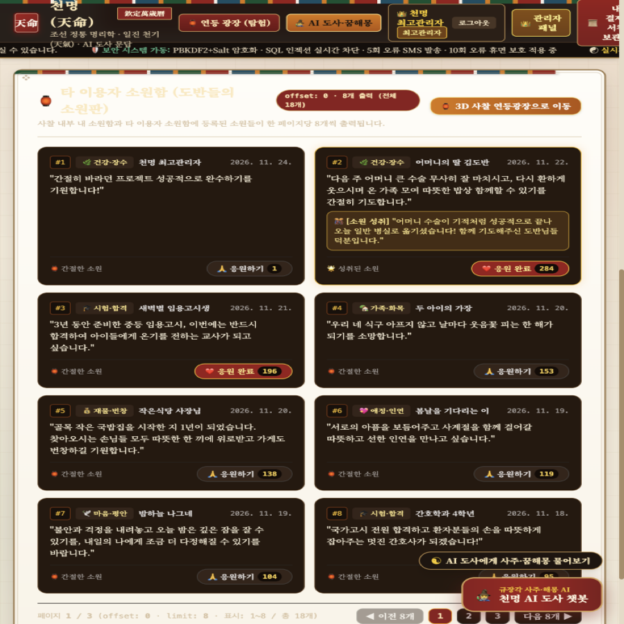<br/>• 한 페이지당 8개씩(`offset: 0, 8...`, `limit: 8`) 출력<br/>• 내 소원판 작성 시 내 소원함+타 이용자 소원함 동시 등록<br/>• `"소원이 이루어졌다면, 다시 와서 알려주세요"` 안내<br/>• 연등광장 내 열람 후 `[나가기]` 시 연등광장 즉시 복귀 | 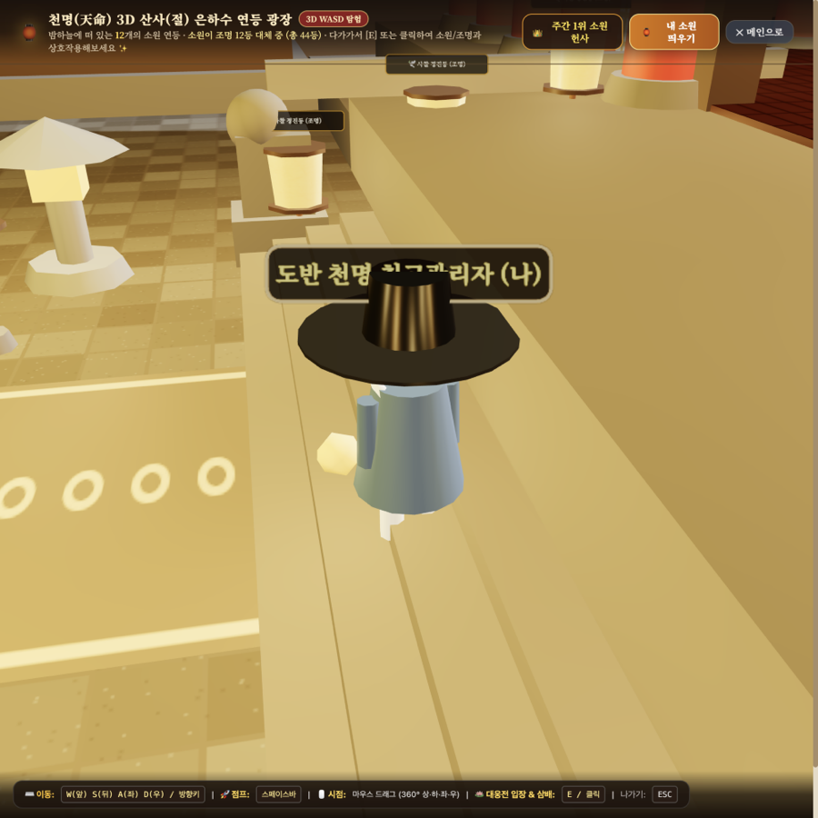<br/>• 11단 통석재 대석계단과 지형 고도 100% 일치<br/>• 계단 오를 때 돌 속으로 파고들지 않는 즉각 스냅 물리<br/>• 20분할 아치 곡선 홍예교(석교) 발바닥 밀착 보행<br/>• 전각 벽체·석탑·내진주·소나무 무관통 슬라이딩 충돌 |

---

## 3. 🏮 천명 3D 산사(절) 은하수 소원 연등 광장 메타버스 (Three.js WebGL 3D Virtual Temple)

천명(天命) 서비스의 핵심 차별화 기능 중 하나인 **3D 대형 산사 은하수 소원 연등 광장**은 Three.js(WebGL) 엔진을 기반으로 구축된 독립형 가상 사찰 메타버스 공간입니다. 브라우저에서 별도의 플러그인 설치 없이 60fps 이상의 부드러운 3D 그래픽을 렌더링하며, 사용자가 직접 도반 아바타를 조작하여 사찰 경내를 거닐고 부처님께 삼배를 올리며 소원 등불을 밤하늘로 띄울 수 있습니다.

```mermaid
graph TB
    subgraph Engine ["🎮 Three.js WebGL 3D Engine (`wish_plaza.js`)"]
        Render["3D Scene / PerspectiveCamera / WebGLRenderer<br/>(그림자 맵 · 안개 · DirectionalLight · AmbientLight)"]
        Physics["물리 & 충돌 감지 엔진 (No-Clipping)<br/>• AABB & 원형 Collider (대웅전 벽체, 내진주, 석탑, 불단, 연못)<br/>• X/Z축 독립 분할 충돌 검사 & 벽면 미끄러짐(Sliding)"]
        Elevation["정밀 지형 고도 맵 (Zero-Sinking Elevation)<br/>• 평지(y=0) ➔ 20분할 아치 홍예교(y=0.35~0.9) ➔ 11단 통석재 계단(y=0.38~3.85) ➔ 마루(y=3.85)"]
        Audio["Web Audio API 사찰 & 폭죽 음향 엔진<br/>• 싱잉볼(Singing Bowl) 배음 합성 · 5연발 폭죽음 · 동전 골인 차임벨 · 물방울 파문음"]
    end

    subgraph TempleSpace ["🏯 일본 선사(禪寺) & 한국 전통 조화 가상 사찰 공간"]
        OutCourtyard["경외 및 경내 마당<br/>• 8기 대형 목조 연등 기둥(提灯柱, 9.5m) & 기둥-기둥 공중 연결선(로프) 연등<br/>• 동전 던지기 연못(投銭池 · 구멍 반경 0.25m 정밀 골인 판정)<br/>• 연화지(연못) & 20분할 아치 홍예교 & 중앙 삼층석탑"]
        Daeungjeon["대웅보전 (천명전) 실내 공간 (폭 60m · 깊이 40m)<br/>• 본당 내부 불단 좌우 2기 츠리도로(釣燈籠) 미니멀 조명<br/>• 서쪽 벽: 📜 내 소원판(絵馬掛所 · 소원 작성 & 성취 소식 등록)<br/>• 동쪽 벽: 🏮 타 이용자 소원함(동일 에마걸이 형태 · 8개 offset 열람)<br/>• 3단 수미단 & 삼존불(황금 석가모니불 + 문수·보현보살) & 향연기 파티클"]
    end

    subgraph UserActions ["🧘 사용자 · 자율 NPC 인터랙션 & 예법"]
        SkyLaunch["열기구 소원 등불 하늘 발사<br/>➔ 상공 5연발 폭죽 개화 & '좋은 일만 있을 거예요 ✨' 축복 배너"]
        WishBoards["내 소원함 + 타 이용자 소원함 동시 등재<br/>소원 성취 실시간 축하 패널 (타 사용자 이벤트 시에만 노출 · 1인 최대 3회)"]
        NpcAI["최대 5인 자율 도반 NPC AI<br/>무작위 산책 · NPC끼리/플레이어와 90도 상호 인사(G/클릭) · 불단 참배 절하기"]
        CoinToss["동전 연못(投銭池) 동전 던지기 [C / 클릭]<br/>구멍 정중앙 진입 시 수직 낙하 & 10종 행운 덕담"]
        Bow["현실적 4단계 합장 삼배(三拜) 풀 애니메이션 & ESC 안전 퇴장 모달<br/>(서브 모달 나가기 시 사주화면 아닌 연등광장으로 즉시 복귀)"]
    end

    Engine --> TempleSpace
    TempleSpace --> UserActions
```

### 1) 일본 사찰식 기둥-기둥 공중 로프(선) 연등 구조 & 본당 미니멀 츠리도로
- **기둥과 기둥을 연결한 공중 현수선(Catenary Rope) 연등 (바닥 연등 0개)**:
  - 바닥에 석등이나 낮은 말뚝을 두지 않고, 경내 마당 좌우(`x = ±11m`, `z = 16, 3, -9, -21`)에 **높이 9.5m의 흑갈색 편백나무 연등 기둥(`提灯柱`) 8기**를 세웠습니다.
  - 각 기둥 상단(`y = 8.9m`)의 붉은 매듭에서 다음 기둥으로 이어지는 **11구간의 공중 연결선(좌·우 세로 6구간 + 마당 상공 횡단 3구간 + 본당 처마 연결 2구간)**을 시공하고, 그 공중 선에 소원 연등과 봉납 제등(`奉納 提灯`)들이 매듭 고리로 주렁주렁 매달려 하늘에서 은은하게 흔들립니다.
- **본당 실내 미니멀 선(禪) 조명**:
  - 폭 60m, 깊이 40m로 확장된 본당(대웅보전) 내부는 천장의 복잡한 등들을 모두 덜어내고 **삼존불 수미단 좌우를 정갈하게 비추는 단 2기의 츠리도로(`釣燈籠`)**만 배치하여 고즈넉한 일본 선사(禪寺)의 여백미를 살렸습니다.

### 2) 열기구(천등)형 소원 등불 상승 ➔ 5연발 폭죽 개화 ➔ 축복 메시지
- `[🏮 내 소원 띄우기]` 또는 사찰 내부 `내 소원판`에서 소원을 작성하면 캐릭터 앞에서 불꽃을 품은 열기구 형태의 소원 등불이 생성되어 밤하늘 높이(`y ≈ 35m`) 천천히 떠오르며 카메라가 상승 궤적을 따라 비춥니다.
- 등불이 밤하늘 정점에 도달하면 **황금·산호·비취·하늘빛 5연발 폭죽 파티클과 폭죽 음향**이 화려하게 터지고, 화면 중앙에 **`"🎆 당신의 소원이 하늘에 닿았어요 — 좋은 일만 있을 거예요 ✨"`** 축복 배너가 표시된 뒤 하늘과 공중 로프에 내 소원 등불이 자리 잡습니다.

### 3) 사찰 내부 서쪽 '내 소원판(`📜 내 소원함`)' & 성취 축하 시스템 (1인 최대 3회)
- **갈망하는 소원 적고 걸기 & 안내 멘트**:
  - 본당 내부 서쪽 벽(`x = -28.0, z = -40.5`)의 목조 에마걸이(`絵馬掛所`) 앞에서 `[E]` 또는 클릭 시 내 소원판 모달이 열립니다.
  - 소원을 적고 걸면 **`"소원이 이루어졌다면, 다시 와서 알려주세요"`** 안내 멘트가 표시되며, **내 소원함 + 타 이용자 소원함(동쪽 벽 에마걸이 & 백엔드 서버 & 8개 단위 목록)**에 동시에 추가됩니다.
- **연등광장 내부 전용 실시간 소원 성취 축하 (1인 최대 3번 제한)**:
  - 소원을 이룬 사용자가 다시 찾아와 내 소원판에서 성취 소식을 남기면(`POST /api/plaza/fulfillments`), **연등광장 내부(`#wishPlazaSection`)에서만** 좌측 상단 실시간 축하 패널과 축하 폭죽이 동작합니다.
  - 광장에 접속한 도반들은 성취 소식에 **`[👏 축하 보내기]`**(`POST /api/plaza/fulfillments/{id}/congratulate`)를 누를 수 있으며, **한 사람당 최대 3번(`0/3 ➔ 1/3 ➔ 2/3 ➔ 3/3회 완료`)까지만** 축하가 허용됩니다(4번째 클릭 시 한도 안내 토스트와 함께 차단).

### 4) 사찰 내부 반대편 동쪽 '타 이용자 소원함' & 8개 단위(`offset`) 열람 및 연등광장 복귀
- **내 소원함 정반대편 동일 형태 배치**:
  - 본당 내부 서쪽 `내 소원함`(`x = -28.0`) 정반대편인 **동쪽 벽(`x = +28.0, z = -40.5`)**에 동일한 목조 에마걸이 형태의 **`🏮 타 이용자 소원함`**을 배치했습니다.
- **`"타 이용자의 소원을 보시겠습니까 ?"` 예 / 아니요 모달 & 8개(`offset`) 페이지네이션**:
  - 동쪽 벽 타 이용자 소원함 앞에서 `[E]` 또는 클릭 시 **`"타 이용자의 소원을 보시겠습니까 ?"`** 안내 문구와 **`[예]` / `[아니요]`** 선택 창이 뜹니다.
  - **`[예]`** 선택 시 한 페이지당 **정확히 8개씩(`offset: 0, 8, 16...`, `limit: 8`)** 타 이용자들의 소원을 열람하고 응원할 수 있습니다(홈페이지 첫 화면 하단 스크롤 영역 `#homeCommunityWishSection`에서도 동일하게 한 페이지 8개 `offset` 단위로 출력).
- **서브 모달 `[나가기]` 시 사주 화면이 아닌 연등광장으로 즉시 복귀**:
  - 연등광장 내부에서 타 이용자 소원함이나 내 소원함을 본 뒤 **`[✕ 나가기 (연등광장으로)]`** 버튼이나 `ESC`를 누르면 사주 입력 화면으로 넘어가지 않고 **캐릭터가 서 있던 3D 연등광장 화면으로 즉시 복귀**합니다.

### 5) 작은 동전 연못 (`投銭池`) — 구멍 정중앙(`반경 0.25m`) 물리 판정 & 행운 덕담
- 사찰 마당 서편(`x = -18, z = 8`)에 조성된 작은 동전 연못 한가운데에는 **황금 테두리가 둘러진 작은 구멍 바위(검은 구멍 개구부 반경 `0.40m`)**가 자리하고 있습니다.
- 연못 근처에서 마우스로 구멍을 조준해 클릭하거나 `[C]` 키를 누르면 황금 동전(반경 `0.18m`)이 포물선 궤적으로 날아가며, 실제 착지 좌표와 구멍 중심 사이의 유클리드 거리를 정밀 계산합니다:
  - **구멍 정중앙 골인 (`거리 ≤ 0.25m`)**: 동전이 테두리에 걸리지 않고 **실제 구멍 안쪽에 정확히 들어갔을 때만** 구멍 속으로 수직 낙하하는 애니메이션과 맑은 차임벨 소리가 울리며, `"🪙 쏙! 동전이 구멍 정중앙에 정확히 들어갔어요!"`와 함께 10종의 행운 덕담 배너가 출력됩니다.
  - **바위·황금 테두리 충돌 (`0.25m < 거리 ≤ 1.18m`)**: 동전이 바위 테두리에 맞고 물속으로 튕겨 나가며 `"🪨 쨍그랑! 구멍 테두리 바위에 맞고 튕겨 나갔어요 (중심 오차 XXcm)"`가 표시됩니다.
  - **연못 수면 낙하 (`거리 > 1.18m`)**: 수면에 물결 파문이 일며 `"💦 퐁당! 구멍에 들어가지 않고 물속에 빠졌어요"`가 표시됩니다.

### 6) 최대 5인 자율 도반 NPC · 90도 상호 인사 · 현실적 4단계 삼배 & 무침하 물리 엔진
- **정면·관절 분리 한복 아바타 & 최대 5인 자율 도반 NPC (`김서연·박지훈·이하늘·정민수·최수아`)**:
  - 로컬 `+Z` 정면(눈·눈썹·코·미소·갓끈·동정·옷고름·앞코 신발)과 `-Z` 후면(뒷머리)을 명확히 구분하고, 허리·어깨·고관절·무릎 관절을 독립 분리했습니다.
  - 경내 마당(3명)과 대웅전 실내(2명)에 배치된 **최대 5명의 도반 NPC**가 충돌 회피(슬라이딩)를 적용해 무작위로 사찰을 거닙니다.
  - **NPC끼리 & 플레이어와의 90도 상호 인사**: 두 도반 NPC가 서로 가까워지거나 플레이어가 도반 앞에서 `[G]` 키 또는 도반을 클릭하면 서로 정면으로 마주 보고 공수 자세로 **정확히 90도(`Math.PI / 2`) 상호 인사**(`🙇 90도 인사 중`)를 나눕니다.
  - **NPC 자율 참배 절하기 (사찰 내 방석 전용)**: 본당 도반 NPC는 주기적으로 삼존불 앞 연화문 방석으로 걸어가 부처님을 향해 **현실적인 4단계 참배 절**(`🪷 참배 절하는 중`)을 올립니다(야외 마당에서는 산책과 90도 상호 인사만 수행).
- **현실적인 4단계 합장 삼배(三拜) & 깔끔한 HUD · 이벤트 기반 축하 패널**:
  - 본당 삼존불 앞 방석(`z = -57.5m`)에서 `[E]` 키 입력 시 **① 서서 합장 → ② 무릎 꿇고 정강이를 뒤로 접기 → ③ 양손을 방석 앞으로 짚으며 82° 깊게 엎드리기(접족례) → ④ 부드럽게 기립**의 4단계 동작으로 3회(삼배) 정성스럽게 절합니다.
  - 상단 헤더의 불필요한 `3D WASD 탐험` 배지를 제거하고, `소원 성취 도반 축하하기` 패널은 기본 상태에서 숨겨 두었다가 **타 사용자의 실제 성취 이벤트가 발생했을 때만** 표시되도록 개선했습니다.
- **11단 통석재 대석계단 & 20분할 아치 홍예교 & ESC 안전 퇴장**:
  - 각 계단 단을 지면부터 상면(`0.38m ~ 3.85m`)까지 꽉 찬 통석재 블록으로 시공하고 `getGroundElevation`과 100% 일치시켜 계단을 오를 때 캐릭터가 계단 안으로 파고드는 현상을 원천 제거했습니다.
  - 홍예교(석교) 상판과 난간도 20분할 아치 곡선 세그먼트로 시공하여 다리 위를 걸을 때 발바닥이 상판에 정확히 밀착됩니다.
  - 3D 광장에서 `ESC` 입력 시 즉시 종료되지 않고 `"정말 연등 광장에서 나가시겠습니까? [네 / 아니요]"` 확인 모달이 호출됩니다.

---

## 4. 👑 시스템 최고 관리자 계정 및 보안 관제실 (System Security & Administration)

천명(天命) 서비스는 엔터프라이즈급 시스템 보안 관제 및 실시간 운영을 위해 **최고 관리자(ROLE_ADMIN) 계정과 전용 통합 관제실 모달**을 기본 탑재하고 있습니다. 서버 구동 시 `AdminInitializer`(`ApplicationRunner`)가 실행되어 데이터베이스 내 관리자 계정 유무를 자동 감지하고 최신 보안 규격으로 안전하게 생성·유지합니다.

> [!IMPORTANT]
> **🔐 Git 시크릿 유출 방지 및 보안 환경변수 분리 적용**
> - 시스템 관리자 비밀번호 및 데이터베이스 접속 정보는 소스코드 및 공개 Git 저장소에 평문으로 커밋되지 않도록 **운영체제 환경변수(`ADMIN_PASSWORD`, `DB_PASSWORD`) 주입 방식**으로 완벽히 분리·강화되었습니다.
> - 클라이언트 화면(로그인 모달)에서도 관리자 비밀번호 평문 노출을 원천 제거하였으며, 빠른 입력 버튼 클릭 시 관리자 계정 ID(`admin`)만 안전하게 완성되고 비밀번호는 운영자가 직접 입력하도록 보안 조치되었습니다.

### 🔑 관리자 보안 접속 규격
| 항목 | 접속 규격 | 상세 설명 및 보안 조치 |
| :---: | :---: | :--- |
| **관리자 아이디 (ID)** | `${ADMIN_ID:admin}` | 환경변수 `ADMIN_ID` 주입 (기본값: `admin`) |
| **관리자 비밀번호 (PW)** | `${ADMIN_PASSWORD}` | 환경변수 `ADMIN_PASSWORD` 주입 (단방향 PBKDF2 해싱 저장, 소스코드 평문 제거) |
| **관리자 명칭** | `천명 최고관리자` | 헤더 및 관제실 내 👑 황금 최고관리자 배지 표시 |
| **시스템 권한** | `ROLE_ADMIN` | 일반 회원(`ROLE_USER`)과 분리된 통합 관제 권한 |
| **암호화 알고리즘** | `PBKDF2WithHmacSHA256` | 16바이트 암호학적 랜덤 Salt + 65,536회 반복 해싱 (복호화 불가능한 안전한 단방향 저장) |
| **빠른 계정 입력** | `[관리자 ID 입력]` 지원 | 운영 편의를 위해 아이디 자동 완성 지원 (비밀번호는 수동 입력) |

### 🛠️ 관리자 전용 REST API (`/api/admin/*`)
| HTTP Method | Endpoint | 설명 | 필수 권한 |
| :---: | :--- | :--- | :---: |
| `GET` | `/api/admin/stats` | 전체 회원수, 정상/휴면 계정, 500원 누적 결제금액/건수, AI 문답수 통합 통계 집계 | `ROLE_ADMIN` |
| `GET` | `/api/admin/accounts` | 가입 회원 전체 목록 및 실패 횟수, 계정 상태(ACTIVE/DORMANT_LOCKED) 조회 | `ROLE_ADMIN` |
| `POST` | `/api/admin/accounts/{id}/unlock` | 비밀번호 10회 오류로 휴면 잠금된 회원 계정을 관리자 권한으로 즉시 해제 및 오류 초기화 | `ROLE_ADMIN` |

### 🖥️ 관리자 관제실 화면 기능
- **실시간 4대 핵심 지표 카드**: 가입 회원 총계, 10회 오류 휴면 계정, 500원 결제 누적 금액/건수, AI 도사 문답수 실시간 모니터링
- **회원 보안 계정 관리 테이블**: 가입자 목록, 권한 배지, 연속 실패 횟수, 계정 상태(정상/경고/휴면잠금) 표시
- **원클릭 계정 복구 액션**: `[🔓 잠금·오류 초기화]` 버튼 클릭 시 해당 회원의 실패 카운터를 0으로 리셋하고 즉시 정상 활성화(ACTIVE)로 복원

---

## 5. 📥 카테고리별 인터랙티브 서책 자료 내보내기 (PDF 대체 독립형 뷰어)

정적이고 딱딱한 PDF 인쇄 방식의 한계를 극복하고, 사용자가 브라우저에서 **각 카테고리별 탭을 직접 클릭하여 자유롭게 열람할 수 있는 독립형 인터랙티브 디지털 서책(`.html`) 내보내기** 기능을 제공합니다.

### 🌟 핵심 특장점
- **무설치 오프라인 독립 실행**: 다운로드된 단일 HTML 파일(`천명_사주운세_인터랙티브_서책_[이름]_[날짜].html`)을 더블클릭하면 PC·태블릿·스마트폰 브라우저에서 인터넷 연결 없이도 즉시 실행됩니다.
- **7대 카테고리별 탭 탐색기**:
  1. `🌟 오늘의 천기 & 일진 운세`: 종합 운세 점수, 4대 세부 지수(재물·애정·건강·직업), 12시진 시간대별 길흉 테이블, 행운 아이템
  2. `📜 사주 원국 (4주 8자 & 10년 대운)`: 시주·일주·월주·년주 천간/지지/십신 만세력 표, 60갑자 일주론, 사주가 좋은 이유 3가지
  3. `☯ 오행 밸런스 & 맞춤 용신`: 목·화·토·금·수 오행 컬러 게이지 바, 신강·신약 판정, 조후·억부 맞춤 용신 개운 비책
  4. `🔮 8대 신살 분석`: 천을귀인, 문창귀인, 도화살, 화개살, 역마살 등 기둥별 길흉 신살 해설
  5. `🧭 미래 진로 & 평생 재물 전략`: 타고난 천직과 직업 적성, 평생 재물 축적 및 투자 주의 시기
  6. `🃏 3-Card 타로 점괘`: 과거-현재-미래 3장 카드 스프레드, 정/역방향 표시, 핵심 키워드 및 실천 조언
  7. `🧙‍♂️ AI 도사 상담 문답 이력`: 사용자가 AI 도사와 나눈 사주·꿈해몽 1:1 대화 로그 원문
- **보기 모드 전환 지원**:
  - `📑 카테고리별 탭 보기`: 원하는 카테고리를 눌러 깔끔하게 하나씩 집중 열람
  - `📖 전체 한눈에 보기`: 모든 카테고리를 한 번에 아래로 스크롤하며 연속 열람
  - `📋 텍스트 복사`: 노션, 메모장, 카카오톡 공유용 마크다운 형식 텍스트 전체 복사

---

## 6. 🔮 마음 치유 & 앞날 설계 부가 서비스 (Daily Wellness & Guidance)

사용자의 **하루의 기분(心象)을 치유하고 앞날에 실질적인 희망과 통찰을 전하는 부가 기능**을 독자적으로 구축하였습니다.

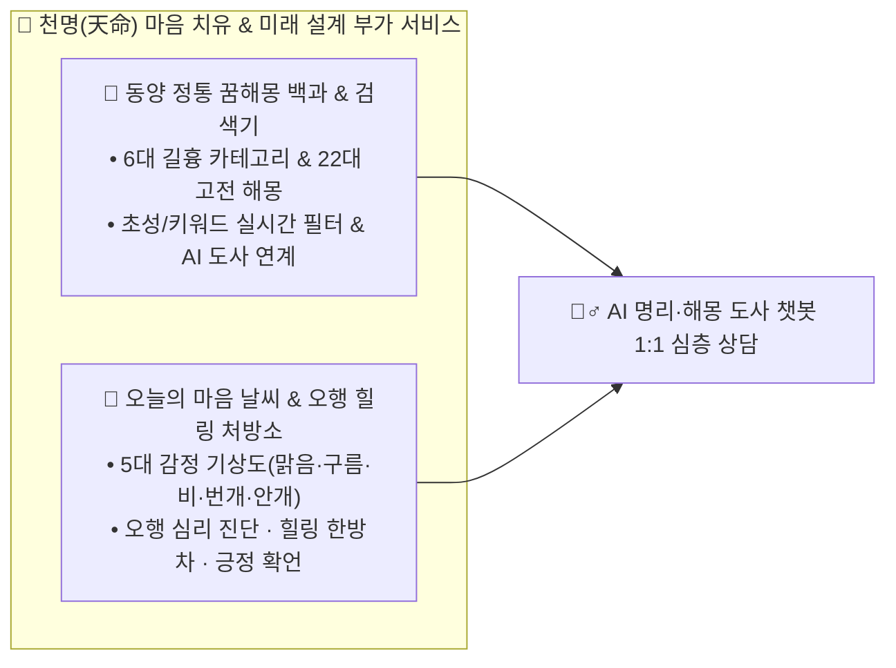

### 1) 🌙 동양 정통 꿈해몽 (夢兆) 백과사전 & 실시간 검색기
- **고전 주공해몽(周公解夢) 22대 핵심 표제어 수록**:
  - `🐷 재물·횡재`: 황금 돼지, 똥 밟는 꿈, 조상님 보따리, 맑은 물 차오름, 황금 열쇠/보석
  - `🐍 길조·태몽`: 황룡·청룡 승천, 구렁이/백사, 만개한 연꽃, 큰 호랑이 포효
  - `🦷 신체·건강`: 이빨 빠짐, 머리카락 길어짐, 맑은 피 흘림, 날개 달고 비행
  - `🌊 자연·환경`: 집 화재/불길, 거센 비바람, 눈 덮인 명산, 태양/달 삼킴
  - `🎓 시험·성공`: 높은 산 정상 등극, 큰 활/칼 획득, 큰 물고기 맨손 포획
  - `⚠️ 주의·경계`: 흙탕물 빠짐, 신발 분실, 쫓기며 다리 굳음
- **실시간 반응형 키워드 검색 & 원클릭 카테고리 필터**:
  - 검색창에 "돼지", "이빨", "용" 등 단어 입력 시 0.05초 내 실시간 카드 필터링
  - 길몽(吉夢)과 흉몽(凶夢) 뱃지, 핵심 해몽 요약, 실생활 실천 조언 카드 제공
  - 더 깊은 해몽이 필요한 경우 `[도사에게 더 묻기 ➔]` 버튼으로 AI 도사 챗봇에 즉시 프롬프트 자동 전달 연동

### 2) 🧘 오늘의 마음 날씨 & 오행 힐링 처방소
- **5대 감정 기상도 (心象 天氣)**:
  - `☀️ 맑음 & 활기`: 목(木)·화(火) 상승 에너지 → 유자/감귤차, 코랄 오렌지, 감사 일기 3줄 작성
  - `⛅ 구름 & 평온`: 토(土) 중심 균형 에너지 → 둥굴레/보리차, 샌드 베이지, 10분 온전한 산책
  - `🌧️ 비 & 울적`: 수(水) 과다 & 목(木) 소생 필요 → 대추/카모마일차, 파스텔 핑크, 따뜻한 샤워 & 나 안아주기
  - `⚡ 번개 & 분노`: 화(火) 폭주 & 수(水) 진정 필요 → 페퍼민트/국화차, 딥 네이비, 4-7-8 심호흡 5회
  - `🌫️ 안개 & 불안`: 토(土) 결핍 & 금(金) 정돈 필요 → 생강/도라지차, 클라우드 화이트, 해야 할 일 1개만 정하기
- **오행 기반 심리 분석 & 하루 긍정 확언 (Daily Affirmation)**:
  - 감정 상태를 사주 오행의 기운 순환과 연계하여 심리 상태를 과학적·철학적으로 위로
  - 매일 마음을 다잡고 앞날을 밝혀주는 영감 넘치는 긍정 확언 문구 탑재

---

## 7. 🛠 기술 스택 및 라이브러리 명세 (Tech Stack)

| 영역 | 기술 / 라이브러리 | 버전 | 적용 및 구현 역할 |
| :---: | :--- | :---: | :--- |
| **Language** | Java (OpenJDK) | `21 LTS` | 백엔드 비즈니스 로직, 보안 암호화, AI 명리·꿈해몽 추론 엔진 구현 |
| **Framework** | Spring Boot | `4.1.2` | 내장 Tomcat 웹 서버(`8085`), RESTful API, `HttpSession` 인증 관리 |
| **Database** | MySQL | `8.x` | `utf8mb4` 기반 11대 정규화 엔티티 테이블 영구 저장 및 트랜잭션 관리 |
| **ORM / JPA** | Spring Data JPA (Hibernate) | `7.4.x` | 엔티티 매핑, `@OneToOne`/`@OneToMany` 영속성 전이(`CascadeType.ALL`) |
| **JDBC** | Spring JDBC (`JdbcTemplate`) | `7.0.x` | `DataSource` 커넥션 메타데이터 진단, 다중 테이블 SQL JOIN 직접 쿼리 |
| **3D Engine** | Three.js (WebGL) | `0.160+` | 3D 가상 사찰 메타버스, 대웅전 실내, 황금 불상, 합장 삼배 애니메이션, 충돌/고도 맵 |
| **Audio Engine**| Web Audio API | `Standard` | 사찰 싱잉볼(Singing Bowl) 타종음 합성 및 파티클 연동 |
| **Security** | `PBKDF2WithHmacSHA256` & `SecurityUtils` | `Custom` | 16바이트 랜덤 Salt 해싱, SQL 인젝션 시그니처 차단, XSS 정화, SMS 휴면해제 |
| **Payment BM** | 토스페이 · 카카오페이 · 네이버페이 모달 | `500 KRW` | 오늘의 운세 무료 / 정통 사주 500원 결제 승인 후 화면 전환 게이트키핑 |
| **Built-in AI** | `AiCounselorService` (명리·꿈해몽 AI) | `Built-in` | 사주·일진·용신 실시간 컨텍스트 결합 1:1 상담 및 동양 정통 주공해몽(꿈해몽) |
| **Frontend** | HTML5 / Tailwind CSS / ES6+ | `Standard` | 한국 전통 단청·한지·창살·낙관 디자인, 실시간 천기 전광판, 타이핑 스트리밍 UI |
| **API Docs** | SpringDoc OpenAPI (Swagger) | `3.2.0` | `/swagger-ui.html` 기반 전체 REST API 명세 시각화 및 즉시 호출 테스트 |

---

## 8. 🏗 핵심 아키텍처 및 도메인별 세부 구현 메커니즘 (System Architecture)

### 8-1. 전체 시스템 계층형 아키텍처 (Layered Architecture)

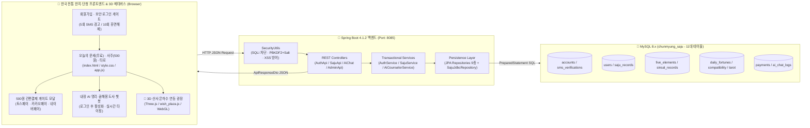

### 8-2. 6대 핵심 도메인별 세부 구현 내용

| 구분 | 담당 클래스 / 파일 | 세부 구현 메커니즘 및 핵심 로직 |
| :---: | :--- | :--- |
| **1. 회원가입 · 로그인 게이트 및 단계별 계정 보호** | `AuthApiController`<br/>`AuthService`<br/>`SecurityUtils` | • **초기 접속 게이트**: 비로그인 상태로 접속 시 사주 입력창과 AI 도사 챗봇을 숨기고 **로그인/회원가입 화면(`#authSection`)**을 먼저 띄웁니다.<br/>• **비밀번호 암호화**: 평문 저장 없이 계정별 16바이트 `SecureRandom` Salt + `PBKDF2WithHmacSHA256`(65,536회 반복) 단방향 해시와 상수 시간 비교(`verifyPassword`)를 적용했습니다.<br/>• **1~4회 오류 (5회 미만)**: `failed_attempts`를 증가시키고 남은 시도 횟수 경고 메시지를 반환합니다.<br/>• **5~9회 오류 (5회 이상)**: 계정 상태를 `WARNING_SMS_SENT`로 전환하고, 가입된 휴대폰 번호로 **6자리 본인확인 인증번호 문자(SMS)**를 발송(`sms_verifications` 테이블 저장 및 화면 상단 SMS 도착 배너 표출)합니다.<br/>• **10회 이상 오류**: 계정을 즉시 **`DORMANT_LOCKED`(휴면·잠금)** 처리하여 이후 비밀번호가 맞아도 로그인을 차단하고, **[🔓 휴면·잠금 해제]** 탭에서 휴대폰 SMS 인증번호 6자리를 검증해야만 `ACTIVE` 및 실패 횟수 `0`으로 초기화합니다. |
| **2. SQL 인젝션 2중 방어 및 웹 보안** | `SecurityUtils`<br/>`SajuJdbcRepository` | • **1차 방어 (`PreparedStatement`)**: 모든 JPA 및 `JdbcTemplate` 쿼리에서 문자열 결합을 배제하고 `?` 파라미터 바인딩만 사용합니다.<br/>• **2차 방어 (`validateNoSqlInjection`)**: `SELECT`, `UNION`, `DROP`, `DELETE`, `OR 1=1`, `--`, `/* */`, `;` 등 SQL 인젝션 공격 시그니처 정규식을 클라이언트와 서버 양단에서 검사하여 탐지 즉시 `400 Bad Request`로 차단합니다.<br/>• **XSS 방어 (`sanitizeXss`)**: `<`, `>`, `&`, `"`, `'` 특수문자를 이스케이프 처리합니다. |
| **3. 오늘의 운세 작동 메커니즘 (100% 무료)** | `fortune.js`<br/>`calendar.js`<br/>`saju.js` | • 상용 운세 플랫폼(포스텔러·점신)의 일진 알고리즘을 반영하여 **[사용자 본원 일간·일지·용신]**과 **[당일 60갑자 일진]**을 매칭합니다.<br/>• **① 십신(十神) 작용**, **② 12운성(十二運星: 장생·관대·건록·제왕 등 12단계 에너지 바이오리듬)**, **③ 천간합·지지육합·천간충·지지충 실시간 신호등 트리거**, **④ 시두법(時頭法) 4대 시간대별 흐름**, **⑤ 결핍 오행/용신 기반 개운 음식·컬러·하도 수리 숫자·방위**를 결정론적 알고리즘으로 산출합니다. |
| **4. 사주팔자 500원 유료화 게이트 & 3사 간편결제** | `SajuApiController`<br/>`SajuService`<br/>`PaymentEntity` | • **무료/유료 분리**: 오늘의 운세와 타로는 무료(`FREE`)로 즉시 열람되며, 정통 사주팔자는 **500원 유료(`500원`)** 서비스로 운영됩니다.<br/>• **결제 후 화면 전환 게이트키핑**: 사주팔자 모드에서 조회 버튼을 누르면 결과 화면으로 넘어가지 않고 입력 화면 위에서 **`"💳 500원 결제를 진행하시겠습니까?"`** 모달이 먼저 팝업됩니다. 결제 취소 시 입력 화면에 머무르며, **토스페이(`TOSS_PAY`) · 카카오페이(`KAKAO_PAY`) · 네이버페이(`NAVER_PAY`)** 중 하나를 선택해 최종 결제 승인(`POST /api/payment/checkout`)을 완료해야만 MySQL `payments` 테이블에 영수증(`ORD-YYYYMMDD-XXXXXX`)이 기록되면서 사주 결과 화면으로 전환됩니다. |
| **5. 내장형 AI 명리 · 꿈해몽 도사 챗봇** | `AiChatController`<br/>`AiCounselorService`<br/>`AiChatLogEntity` | • **로그인 후 전용 노출**: 로그인 전에는 챗봇 버튼과 드로어가 완전히 숨겨지며, 로그인 완료 후에만 우측 하단 플로팅 도사 버튼과 상단 헤더 버튼이 활성화됩니다.<br/>• **사주 컨텍스트 실시간 연동**: 사용자의 일주, 수호동물, 신강/신약, 용신, 오늘의 십신·12운성·점수를 실시간으로 결합하여 재물·연애·이직·오늘의 비책·용신 개운법을 1:1로 상담합니다.<br/>• **동양 정통 꿈해몽(周公解夢)**: 돼지·똥·황금(`대대길몽 98점`), 용·호랑이·태양(`제왕길몽 97점`), 활활 타는 불(`번창길몽 94점`), 죽음·시체·피(`역몽 대길조 93점`), 조상님(`음덕예지몽 92점`), 뱀·맑은 물·잉어(`지혜·재원 길몽 90점`), 치아 빠짐·쫓기는 꿈(`신중경고몽·심몽`)을 내 사주 일진과 대조해 해몽하고 MySQL `ai_chat_logs` 테이블에 저장합니다. |
| **6. 3D 가상 사찰 메타버스 & 연등 광장** | `wish_plaza.js`<br/>`index.html`<br/>`Three.js WebGL` | • **Three.js WebGL 렌더링**: 대웅보전 실내 진입, 우물마루 바닥, 황금 석가모니불, 수미단, 향연기 파티클, 촛불, 법고, 2,800개 별무리 및 별똥별 연출.<br/>• **물리 및 충돌 엔진**: 건물·조형물 관통 100% 방지 AABB 충돌체 및 X/Z 독립 슬라이딩, 지형 고도 맵(홍예교·계단·마루) 추적.<br/>• **인터랙션 & 예법**: W,A,S,D 보행, Space 점프, 마우스 360도 Orbit 회전/휠 줌, 합장 삼배(三拜) 3회 오체투지 애니메이션, Web Audio API 사찰 싱잉볼 타종, ESC 키 안전 퇴장 모달. |

---

## 9. 🔄 요청-응답 처리 시퀀스 다이어그램 (4-Phase Flow)

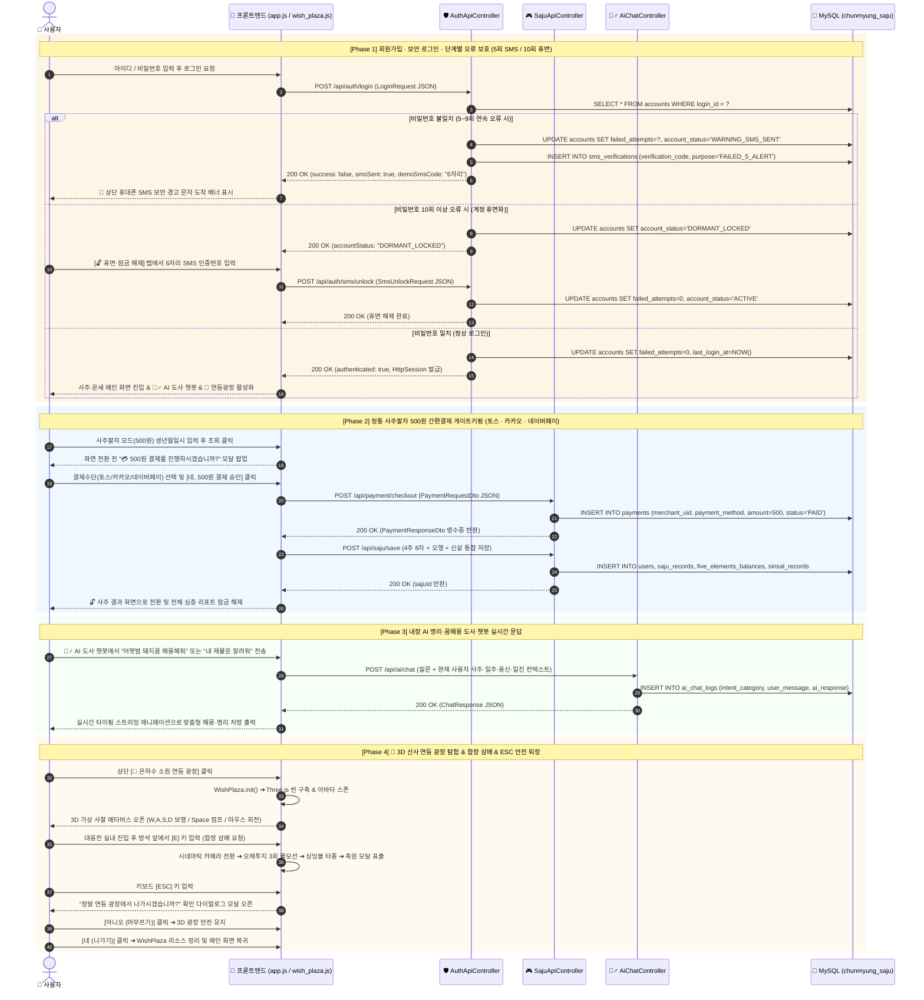

---

## 10. 🗄 데이터베이스 ERD 및 11대 정규화 엔티티 설계 (Database ERD & Entity Specifications)

### 10-1. MySQL 데이터베이스 ERD (`chunmyung_saju`)

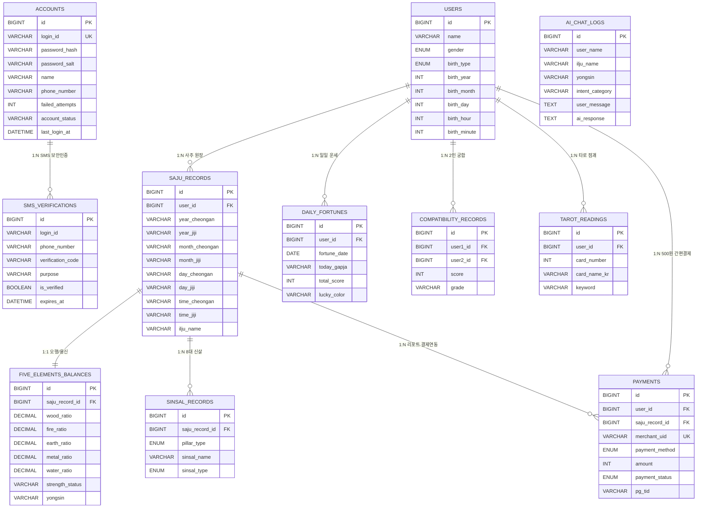

### 10-2. 11대 엔티티 클래스 및 테이블 매핑 요약

> 패키지 경로: `com.chunmyung.saju.entity`

| No. | 엔티티 클래스 | DB 테이블명 | 연관 관계 | 핵심 저장 항목 |
| :-: | :--- | :--- | :---: | :--- |
| **1** | `AccountEntity` | `accounts` | `1 : N` (Auth) | 로그인 ID, PBKDF2 해시·Salt, 휴대폰 번호, 실패 횟수, 휴면 상태 |
| **2** | `SmsVerificationEntity` | `sms_verifications` | `N : 1` (`accounts`) | 수신 휴대폰 번호, 6자리 인증번호, 발송 목적, 만료 일시, 인증 여부 |
| **3** | `UserEntity` | `users` | `1 : N` (Root) | 이름, 성별, 생년월일시, 양·음력·윤달, 30분 시차보정 여부 |
| **4** | `SajuRecordEntity` | `saju_records` | `N : 1` (`users`) | 4주 8자(천간·지지), 본원 일간, 60갑자 일주명, 수호동물, 일주론 |
| **5** | `FiveElementsEntity` | `five_elements_balances` | `1 : 1` (`saju_records`) | 5오행 비율(%), 과다·결핍 오행, 신강·신약 판정, 추천 용신 |
| **6** | `SinsalEntity` | `sinsal_records` | `N : 1` (`saju_records`) | 기둥별 8대 신살(천을귀인·도화살·역마살 등), 길흉 구분 및 해설 |
| **7** | `DailyFortuneEntity` | `daily_fortunes` | `N : 1` (`users`) | 운세 날짜, 일진 간지, 5대 운세 점수, 행운의 색·숫자·방위·총평 |
| **8** | `CompatibilityEntity` | `compatibility_records` | `N : 2` (`users`) | 본인·상대방 궁합 점수, 등급, 천간·지지 합충 분석 및 조언 |
| **9** | `TarotEntity` | `tarot_readings` | `N : 1` (`users`) | 타로 카드 번호(0~21), 한글·영문 카드명, 정·역방향, 키워드·해석 |
| **10** | `PaymentEntity` | `payments` | `N : 1` (`users`) | 주문번호(`ORD-...`), 토스·카카오·네이버페이 수단, 500원, 승인번호 |
| **11** | `AiChatLogEntity` | `ai_chat_logs` | `Independent` | 사용자명, 연동 일주·용신, 질문 의도(`DREAM` 등), 질문 및 AI 답변 |

---

## 11. 📡 RESTful API 상세 명세 (API Specifications & Examples)

모든 REST API 응답은 아래 `ApiResponseDto<T>` 공통 포맷으로 반환됩니다.

| 응답 필드명 | 데이터 타입 | 설명 |
| :---: | :---: | :--- |
| `success` | `boolean` | 요청 처리 성공 여부 (`true` / `false`) |
| `message` | `String` | 처리 결과 또는 단계별 보안 경고 안내 메시지 |
| `data` | `T` (Generic) | 실제 반환 데이터 객체 (인증 상태, 영수증, AI 답변, 저장된 PK ID 등) |

---

### ① 회원가입 API (`POST /api/auth/signup`)

| 항목 | 상세 내용 |
| :---: | :--- |
| **HTTP Method & URI** | `POST /api/auth/signup` |
| **담당 메서드** | `AuthApiController.signup()` ➔ `AuthService.registerAccount()` |
| **구현 동작** | 입력값 SQL 인젝션 검사를 수행한 후, 16바이트 랜덤 Salt와 `PBKDF2WithHmacSHA256`으로 비밀번호를 단방향 암호화하여 `accounts` 테이블에 저장하고 로그인 세션을 발급합니다. |

#### 📥 요청 예시 (Request Body JSON)
```json
{
  "loginId": "hong1234",
  "password": "mySecretPassword!",
  "name": "홍길동",
  "phoneNumber": "010-1234-5678",
  "gender": "M",
  "birthYear": 1995,
  "birthMonth": 5,
  "birthDay": 15
}
```

#### 📤 응답 예시 (Response - 200 OK)
```json
{
  "success": true,
  "message": "홍길동 님, 천명(天命) 회원가입이 완료되었습니다!",
  "data": {
    "authenticated": true,
    "accountId": 1,
    "loginId": "hong1234",
    "name": "홍길동",
    "maskedPhone": "010-****-5678",
    "gender": "M",
    "birthYear": 1995,
    "birthMonth": 5,
    "birthDay": 15,
    "failedAttempts": 0,
    "accountStatus": "ACTIVE",
    "smsSent": false,
    "smsPreviewMessage": null,
    "demoSmsCode": null
  }
}
```

---

### ② 보안 로그인 API (`POST /api/auth/login`) — 5회 오류 SMS 발송 & 10회 휴면화

| 항목 | 상세 내용 |
| :---: | :--- |
| **HTTP Method & URI** | `POST /api/auth/login` |
| **담당 메서드** | `AuthApiController.login()` ➔ `AuthService.loginAccount()` |
| **구현 동작** | • **1~4회 실패**: 실패 횟수 증가 및 경고 메시지 반환<br/>• **5~9회 실패**: `account_status = 'WARNING_SMS_SENT'` 전환 및 등록된 휴대폰으로 6자리 본인확인 SMS 문자 자동 발송 (`sms_verifications` 저장)<br/>• **10회 이상 실패**: `account_status = 'DORMANT_LOCKED'`(계정 휴면화) 전환 및 로그인 전면 차단 |

#### 📥 요청 예시 (Request Body JSON)
```json
{
  "loginId": "hong1234",
  "password": "wrongPassword"
}
```

#### 📤 응답 예시 A (1~4회 비밀번호 오류 시 경고)
```json
{
  "success": false,
  "message": "⚠️ 비밀번호가 일치하지 않습니다. (현재 3회 실패 / 5회 이상 오류 시 휴대폰 문자 발송, 10회 이상 오류 시 계정 휴면화)",
  "data": {
    "authenticated": false,
    "accountId": 1,
    "loginId": "hong1234",
    "name": "홍길동",
    "maskedPhone": "010-****-5678",
    "failedAttempts": 3,
    "accountStatus": "ACTIVE",
    "smsSent": false
  }
}
```

#### 📤 응답 예시 B (5회 이상 비밀번호 오류 시 — 휴대폰 SMS 문자 즉시 발송)
```json
{
  "success": false,
  "message": "🚨 비밀번호 5회 연속 오류! 등록된 휴대폰(010-****-5678)으로 보안 경고 문자가 발송되었습니다. (10회 이상 실패 시 계정이 휴면화됩니다. 남은 기회: 5회)",
  "data": {
    "authenticated": false,
    "accountId": 1,
    "loginId": "hong1234",
    "name": "홍길동",
    "maskedPhone": "010-****-5678",
    "failedAttempts": 5,
    "accountStatus": "WARNING_SMS_SENT",
    "smsSent": true,
    "smsPreviewMessage": "[천명(天命) 보안경고] 비밀번호 5회 연속 오류 감지! 본인확인 인증번호는 [482915] 입니다. (10회 오류 시 계정 휴면화)",
    "demoSmsCode": "482915"
  }
}
```

#### 📤 응답 예시 C (10회 이상 비밀번호 오류 시 — 계정 휴면화 잠금)
```json
{
  "success": false,
  "message": "🔒 비밀번호를 10회 이상 잘못 입력하여 계정이 휴면화(잠금)되었습니다! 휴대폰(010-****-5678)으로 발송된 SMS 인증번호를 입력해야 잠금이 해제됩니다.",
  "data": {
    "authenticated": false,
    "accountId": 1,
    "loginId": "hong1234",
    "name": "홍길동",
    "maskedPhone": "010-****-5678",
    "failedAttempts": 10,
    "accountStatus": "DORMANT_LOCKED",
    "smsSent": true,
    "smsPreviewMessage": "[천명(天命) 긴급보안] 비밀번호 10회 연속 오류로 계정이 휴면화(잠금) 처리되었습니다. 해제 인증번호는 [739104] 입니다.",
    "demoSmsCode": "739104"
  }
}
```

---

### ③ 휴대폰 SMS 인증번호 검증 및 휴면 계정 해제 API (`POST /api/auth/sms/unlock`)

| 항목 | 상세 내용 |
| :---: | :--- |
| **HTTP Method & URI** | `POST /api/auth/sms/unlock` |
| **담당 메서드** | `AuthApiController.unlockWithSms()` ➔ `AuthService.unlockAccountWithSms()` |
| **구현 동작** | 아이디, 휴대폰 번호, 6자리 SMS 인증번호(유효시간 5분)를 검증하여 일치하면 `account_status = 'ACTIVE'`, `failed_attempts = 0`으로 초기화하고, 새 비밀번호 입력 시 새 Salt+해시로 변경합니다. |

#### 📥 요청 예시 (Request Body JSON)
```json
{
  "loginId": "hong1234",
  "phoneNumber": "010-1234-5678",
  "verificationCode": "739104",
  "newPassword": "newSafePassword123!"
}
```

#### 📤 응답 예시 (Response - 200 OK)
```json
{
  "success": true,
  "message": "✅ 휴대폰 SMS 인증이 완료되어 계정 휴면(잠금) 및 오류 횟수가 모두 초기화되었습니다! 이제 로그인하실 수 있습니다.",
  "data": {
    "authenticated": false,
    "accountId": 1,
    "loginId": "hong1234",
    "name": "홍길동",
    "maskedPhone": "010-****-5678",
    "failedAttempts": 0,
    "accountStatus": "ACTIVE",
    "smsSent": false
  }
}
```

---

### ④ 유료 사주 500원 간편결제 승인 API (`POST /api/payment/checkout`)

| 항목 | 상세 내용 |
| :---: | :--- |
| **HTTP Method & URI** | `POST /api/payment/checkout` |
| **결제 수단 코드** | `TOSS_PAY` (토스페이), `KAKAO_PAY` (카카오페이), `NAVER_PAY` (네이버페이) |
| **구현 동작** | 사주팔자 모드(500원)에서 사용자가 선택한 간편결제 수단으로 500원 결제를 승인하고, 고유 주문번호(`ORD-YYYYMMDD-XXXXXX`)와 PG 승인번호를 발급하여 MySQL `payments` 테이블에 저장합니다. |

#### 📥 요청 예시 (Request Body JSON)
```json
{
  "name": "홍길동",
  "gender": "M",
  "birthYear": 1995,
  "birthMonth": 5,
  "birthDay": 15,
  "sajuRecordId": 1,
  "productType": "SAJU_FULL_REPORT",
  "productName": "천명(天命) 정통 사주팔자 · 대운 · 심층 리포트 열람권",
  "paymentMethod": "TOSS_PAY",
  "amount": 500
}
```

#### 📤 응답 예시 (Response - 200 OK)
```json
{
  "success": true,
  "message": "토스페이 500원 결제가 완료되었습니다. (주문번호: ORD-20261120-841920)",
  "data": {
    "paymentId": 1,
    "userId": 1,
    "userName": "홍길동",
    "merchantUid": "ORD-20261120-841920",
    "productType": "SAJU_FULL_REPORT",
    "productName": "천명(天命) 정통 사주팔자 · 대운 · 심층 리포트 열람권",
    "paymentMethod": "TOSS_PAY",
    "paymentMethodKr": "토스페이",
    "amount": 500,
    "paymentStatus": "PAID",
    "pgTid": "TOSS_TID_1795180841920",
    "paidAt": "2026-11-20T22:15:30"
  }
}
```

---

### ⑤ 내장형 AI 명리 · 꿈해몽 도사 챗봇 문답 API (`POST /api/ai/chat`)

| 항목 | 상세 내용 |
| :---: | :--- |
| **HTTP Method & URI** | `POST /api/ai/chat` |
| **담당 메서드** | `AiChatController.chat()` ➔ `AiCounselorService.generateCounselReply()` |
| **구현 동작** | 사용자의 질문 의도(`DREAM_INTERPRETATION`, `WEALTH`, `LOVE`, `CAREER`, `TODAY`, `ELEMENT_YONGSIN`, `SINSAL_DAEUN`)를 분류하고, 연동된 사용자의 일주·용신·십신·12운성 컨텍스트와 결합해 맞춤형 명리 상담 및 동양 정통 꿈해몽 답변을 생성한 뒤 MySQL `ai_chat_logs` 테이블에 저장합니다. |

#### 📥 요청 예시 (Request Body JSON — 꿈해몽 질문 시)
```json
{
  "message": "어젯밤 꿈에 돼지와 황금을 본 꿈을 꿨는데 해몽해줘!",
  "userName": "홍길동",
  "gender": "M",
  "iljuName": "병인(丙寅)",
  "dayMaster": "丙",
  "zodiacAnimal": "붉은 호랑이",
  "strengthStatus": "신강(身强)",
  "yongsin": "금(金) / 수(水)",
  "deficientElement": "수(水)",
  "todayTenGod": "식신(食神)",
  "todayTwelveStage": "건록(建祿)",
  "todayScore": 88,
  "luckyColor": "순백의 화이트, 실버",
  "luckyFood": "정갈한 생선구이, 배 도라지차",
  "luckyDirection": "서쪽 (West)",
  "sinsalNames": "천을귀인·홍염살"
}
```

#### 📤 응답 예시 (Response - 200 OK)
```json
{
  "success": true,
  "message": "AI 명리 도사 응답이 생성되었습니다.",
  "data": {
    "chatLogId": 1,
    "intentCategory": "DREAM_INTERPRETATION",
    "intentBadge": "🌙 동양 정통 꿈해몽(夢兆) 처방",
    "reply": "🌙 **홍길동** 님의 꿈자리와 사주 일진을 대조하여 해몽해 드립니다.\n\n• **[해몽 판정]**: **🌟 대대길몽(大大吉夢) — 재물·횡재 지수 98점**\n• **[동양 해몽 원전 풀이]**: 동양 해몽에서 **돼지·황금·대변(똥)**은 오행상 비옥한 **토(土)와 금(金)의 결실**을 뜻하는 최고 으뜸의 재물 길몽입니다...\n• **[사주·일진 결합 행동 지침]**: 오늘 귀하의 일진(**식신(食神) · 건록(建祿)**)과 맞물려 재물복이 크게 열려 있으니...",
    "followUpTip": "💡 다른 꿈도 해몽해 드립니다! 예: '돼지꿈 꿨어', '불이 활활 타는 꿈 해몽해줘', '뱀이 나오는 꿈', '이빨 빠지는 꿈' 등 구체적으로 적어보세요."
  }
}
```

---

### ⑥ 기타 조회 및 저장 엔드포인트 요약

| HTTP Method | Endpoint | 설명 | 사용 기술 |
| :---: | :--- | :--- | :--- |
| `GET` | `/api/auth/check-id?loginId=...` | 회원가입 아이디 중복 여부 및 SQL 인젝션 안전성 검사 | `Spring Data JPA` |
| `POST` | `/api/auth/sms/send` | 휴면·잠금 해제용 6자리 휴대폰 SMS 인증번호 발송 | `Spring Data JPA` |
| `GET` | `/api/auth/me` | 현재 브라우저 `HttpSession` 로그인 세션 상태 확인 | `HttpSession` |
| `POST` | `/api/auth/logout` | 세션 무효화 및 로그아웃 처리 | `HttpSession` |
| `POST` | `/api/saju/save` | 사주 4주 8자, 오행 비율, 8대 신살 통합 저장 | `Spring Data JPA` |
| `POST` | `/api/fortune/save` | 오늘의 일일 운세 점수 및 행운 아이템 Upsert 저장 | `Spring Data JPA` |
| `POST` | `/api/compatibility/save` | 2인 사주 궁합 점수 및 천간·지지 합충 결과 저장 | `Spring Data JPA` |
| `POST` | `/api/tarot/save` | 3-Card 타로 점괘 결과 저장 | `Spring Data JPA` |
| `GET` | `/api/payment/history?limit=10` | `payments` + `users` + `saju_records` JOIN 최근 500원 결제 내역 조회 | `Spring JDBC (JdbcTemplate)` |
| `GET` | `/api/history/recent?limit=10` | `saju_records` + `users` + `five_elements_balances` 3중 JOIN 조회 | `Spring JDBC (JdbcTemplate)` |
| `GET` | `/api/plaza/state` | 연등광장 내부 실시간 소원 목록 및 소원 성취 축하 목록 조회 | `WishPlazaApiController` |
| `GET` | `/api/plaza/wishes?offset=0&limit=8` | 타 이용자 소원함 한 페이지 8개 단위(`offset`, `limit=8`) 페이지네이션 조회 | `WishPlazaApiController` |
| `POST` | `/api/plaza/wishes` | 새 소원 등록 (내 소원함 + 타 이용자 소원함 동시 반영) | `WishPlazaApiController` |
| `POST` | `/api/plaza/fulfillments` | 소원 성취 소식 등록 (연등광장 내부 접속자들에게 실시간 축하 알림) | `WishPlazaApiController` |
| `POST` | `/api/plaza/fulfillments/{id}/congratulate` | 소원 성취 도반에게 축하 보내기 (1인당 최대 3회 제한 검증) | `WishPlazaApiController` |
| `GET` | `/api/jdbc/check` | MySQL JDBC 커넥션 및 드라이버 메타데이터 상태 진단 | `DataSource` / `JDBC` |

---

## 12. 📁 프로젝트 디렉토리 구조 (Directory Tree)

```text
Daily Fortune/
├── pom.xml
├── mvnw
├── mvnw.cmd
├── assets/
│   ├── demo.gif                              # 12대 핵심 워크플로우 순환 데모 GIF (1.55MB)
│   ├── demo.mp4                              # H.264 고화질 데모 동영상
│   ├── step1_auth_login.png                  # Step 1. 보안 로그인·회원가입·SMS 게이트
│   ├── step2_main_hanji_form.png             # Step 2. 한국 전통 한지 사주명식 입력
│   ├── step3_payment_modal_500krw.png        # Step 3. 500원 간편결제 모달
│   ├── step4_saju_unlocked_report.png        # Step 4. 사주·대운 심층 리포트 잠금해제
│   ├── step5_tarot_3card_spread.png          # Step 5. 3-Card 타로 점괘
│   ├── step6_ai_counselor_chatbot.png        # Step 6. 내장 AI 명리·꿈해몽 도사 챗봇
│   ├── step7_wish_plaza_3d.png               # Step 7. 기둥-기둥 공중 로프 연등 & 소원 성취 3회 축하
│   ├── step8_temple_interior_buddha.png      # Step 8. 대웅보전 삼존불 & 서쪽 내 소원판·동쪽 타 이용자 소원함
│   ├── step9_bow_prostration.png             # Step 9. 합장 삼배(三拜) 정성 절하기 풀 애니메이션
│   ├── step10_exit_confirm_modal.png         # Step 10. ESC 안전 퇴장 확인 모달
│   ├── step11_other_wishes_offset8.png       # Step 11. 타 이용자 소원함 8개 단위(offset) 페이지네이션
│   └── step12_stair_climbing_physics.png     # Step 12. 11단 대석계단 무침하 보행 물리 & 동전 연못
└── src/
    └── main/
        ├── java/com/chunmyung/saju/
        │   ├── SajuApplication.java
        │   ├── config/
        │   │   └── WebConfig.java
        │   ├── security/
        │   │   ├── SecurityUtils.java
        │   │   └── AdminInitializer.java
        │   ├── controller/
        │   │   ├── AuthApiController.java
        │   │   ├── SajuApiController.java
        │   │   ├── AiChatController.java
        │   │   ├── AdminApiController.java
        │   │   └── WishPlazaApiController.java  # 🏮 연등광장 소원·8개 offset·성취 3회 축하 API
        │   ├── service/
        │   │   ├── AuthService.java
        │   │   ├── SajuService.java
        │   │   ├── AiCounselorService.java
        │   │   └── AdminService.java
        │   ├── repository/
        │   │   ├── AccountRepository.java
        │   │   ├── SmsVerificationRepository.java
        │   │   ├── UserRepository.java
        │   │   ├── SajuRecordRepository.java
        │   │   ├── FiveElementsRepository.java
        │   │   ├── SinsalRepository.java
        │   │   ├── DailyFortuneRepository.java
        │   │   ├── CompatibilityRepository.java
        │   │   ├── TarotRepository.java
        │   │   ├── PaymentRepository.java
        │   │   ├── AiChatLogRepository.java
        │   │   └── SajuJdbcRepository.java
        │   ├── entity/
        │   │   ├── AccountEntity.java
        │   │   ├── SmsVerificationEntity.java
        │   │   ├── UserEntity.java
        │   │   ├── SajuRecordEntity.java
        │   │   ├── FiveElementsEntity.java
        │   │   ├── SinsalEntity.java
        │   │   ├── DailyFortuneEntity.java
        │   │   ├── CompatibilityEntity.java
        │   │   ├── TarotEntity.java
        │   │   ├── PaymentEntity.java
        │   │   └── AiChatLogEntity.java
        │   └── dto/
        │       ├── ApiResponseDto.java
        │       ├── AuthDtos.java
        │       ├── AiChatDtos.java
        │       ├── PaymentRequestDto.java
        │       ├── PaymentResponseDto.java
        │       ├── SajuSaveRequestDto.java
        │       ├── DailyFortuneSaveRequestDto.java
        │       ├── CompatibilitySaveRequestDto.java
        │       └── TarotSaveRequestDto.java
        └── resources/
            ├── application.yml
            ├── schema.sql
            └── static/
                ├── index.html                   # 메인 SPA + 3D 연등광장 + ESC 모달
                ├── css/
                │   └── style.css                # 단청·한지·3D 캔버스 오버레이 스타일
                └── js/
                    ├── app.js                   # 메인 프론트엔드 컨트롤러
                    ├── data/
                    │   ├── gapja60.js
                    │   ├── sinsal.js
                    │   └── tarot.js
                    └── engine/
                        ├── calendar.js          # 만세력 24절기 역법 엔진
                        ├── saju.js              # 사주 4주 8자 산출 엔진
                        ├── fortune.js           # 오늘의 운세 & 일진 엔진
                        └── wish_plaza.js        # 🏮 Three.js 3D 가상 사찰 메타버스 & 물리/삼배/ESC 엔진
```

---

## 13. 💻 개발 환경 설정 및 MySQL 연동 가이드 (Environment Setup)

| 단계 | 설정 항목 | 설정 값 및 실행 방법 |
| :-: | :--- | :--- |
| **Step 1** | **프로젝트 열기** | IntelliJ IDEA 실행 ➔ `Open` ➔ `Daily Fortune` 폴더 선택 ➔ `Load Maven Project` 클릭 |
| **Step 2** | **Java SDK 설정** | `File` ➔ `Project Structure` (`Cmd + ;`) ➔ **Project SDK: Java 21** 선택 |
| **Step 3** | **Database 탭 연결** | 우측 `Database` 탭 ➔ `+` ➔ `Data Source` ➔ **MySQL** 클릭 |
| **Step 4** | **JDBC 접속 정보** | **Host**: `localhost` · **Port**: `3306` · **Database**: `chunmyung_saju` · **User**: `root` |
| **Step 5** | **커넥션 테스트** | `Test Connection` 클릭 ➔ `Succeeded` 확인 후 `OK` 클릭 |

---

## 14. 🚀 로컬 빌드 및 실행 가이드 (Build & Run Guide)

### 1. MySQL 스키마 초기화
```bash
mysql -u root -p -e "CREATE DATABASE IF NOT EXISTS chunmyung_saju CHARACTER SET utf8mb4 COLLATE utf8mb4_unicode_ci;"
mysql -u root -p chunmyung_saju < src/main/resources/schema.sql
```

### 2. Spring Boot 서버 구동
```bash
./mvnw spring-boot:run
```

### 3. 주요 접속 URL

| 서비스 항목 | 접속 주소 (URL) | 비고 |
| :--- | :--- | :--- |
| **천명(天命) 메인 웹 서비스 & 3D 연등 광장** | `http://localhost:8085/` | 최초 접속 시 로그인 게이트 노출, 로그인 후 상단 탭에서 3D 광장 진입 |
| **Swagger OpenAPI 문서** | `http://localhost:8085/swagger-ui.html` | 전체 API 명세 시각화 및 즉시 호출 테스트 |
| **최고 관리자 전용 관제실** | `http://localhost:8085/` (관리자 로그인 시) | 최고관리자(`admin`) 로그인 시 상단 👑 관제실 버튼 활성화 |
| **JDBC 연결 진단 API** | `http://localhost:8085/api/jdbc/check` | MySQL JDBC 커넥션 상태 확인 |
| **최근 500원 결제 내역 조회 API** | `http://localhost:8085/api/payment/history` | 토스·카카오·네이버페이 결제 원장 조회 |
| **최근 AI 도사 상담 로그 조회 API** | `http://localhost:8085/api/ai/history` | 사주 상담 및 꿈해몽 문답 이력 조회 |
