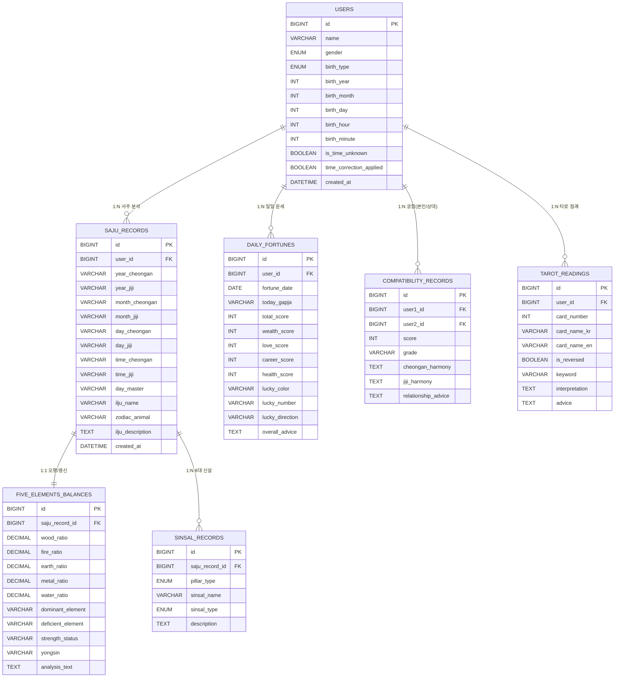

# 🌟 천명(天命) - 정통 사주 만세력 · 오늘의 운세 · 타로 웹 서비스 (Spring Boot & MySQL)

> **한국천문연구원(KASI) 역법 데이터와 정통 명리학(자평진전, 삼명통회, 적천수) 기반의 고정밀 사주 만세력 & 운세 풀스택 웹 애플리케이션**  
> 클라이언트 만세력 연산 엔진과 **Spring Boot 4.x + MySQL 8.x + JDBC / JPA** 백엔드 데이터베이스를 연동하여 사주 원국, 오행 밸런스, 8대 신살, 일일 운세, 궁합, 타로 점괘를 엔티티별로 정규화 저장·관리합니다.


---

## 📌 목차 (Table of Contents)
1. [프로젝트 소개](#-1-프로젝트-소개)
2. [기술 스택 (Tech Stack)](#-2-기술-스택-tech-stack)
3. [핵심 기능 및 명리학 알고리즘](#-3-핵심-기능-및-명리학-알고리즘)
4. [시스템 아키텍처 & DB ERD 설계](#-4-시스템-아키텍처--db-erd-설계)
5. [엔티티별 테이블 명세 (7대 정규화 엔티티)](#-5-엔티티별-테이블-명세-7대-정규화-엔티티)
6. [REST API 명세](#-6-rest-api-명세)
7. [프로젝트 디렉토리 구조](#-7-프로젝트-디렉토리-구조)
8. [IntelliJ IDEA & MySQL JDBC 연동 가이드](#-8-intellij-idea--mysql-jdbc-연동-가이드)
9. [실행 방법](#-9-실행-방법)

---

## 📖 1. 프로젝트 소개

**천명(天命)**은 정통 명리학 알고리즘으로 도출한 사주팔자(四柱八字) 4주 8자 원국과 일일 운세, 2인 궁합, 3-Card 타로 점괘를 제공하는 웹 서비스입니다.  
기존의 단순 정적 페이지/파일 저장 방식을 넘어 **Spring Boot 프레임워크와 MySQL 관계형 데이터베이스를 JDBC 및 JPA로 연동**함으로써, 사용자의 사주 분석 이력과 오행 데이터, 신살, 운세 기록을 엔티티 단위로 세분화하여 영구 보존하고 통계·조회할 수 있도록 설계되었습니다.

---

## 🛠 2. 기술 스택 (Tech Stack)

| 구분 | 기술 및 라이브러리 | 상세 역할 |
| :--- | :--- | :--- |
| **Backend** | **Java 21 (OpenJDK)**, **Spring Boot 4.1.2** | RESTful API 서버 및 정적 리소스 통합 서빙 |
| **Database** | **MySQL 8.x** (`utf8mb4`), **HikariCP** | 사주/운세/궁합/타로 7대 정규화 테이블 영구 저장 및 커넥션 풀 관리 |
| **Persistence** | **Spring Data JPA (Hibernate)**, **Spring JDBC (`JdbcTemplate`)** | 엔티티 연관관계 매핑(ORM) 및 순수 JDBC 기반 직접 SQL JOIN/통계 쿼리 |
| **API Docs** | **SpringDoc OpenAPI 3 (`Swagger UI`)** | REST API 명세 문서 자동화 및 브라우저 내 즉시 테스트 지원 |
| **Frontend** | **HTML5, Tailwind CSS, Vanilla JS (ES6+)** | KASI 역법 기반 만세력 연산 엔진, 12지신 수호동물 인터랙션, 3D 타로 플립 |
| **Build & IDE** | **Maven (`mvnw`)**, **Lombok**, **IntelliJ IDEA** | 의존성 관리, 보일러플레이트 최소화, IDE Database Tools 연동 |

---

## ✨ 3. 핵심 기능 및 명리학 알고리즘

### 🎯 ① 3대 맞춤형 서비스 모드
- **☀️ 오늘의 운세 모드**: 이름, 생년월일, 성별만으로 오늘의 일진(日辰)과 내 사주의 상생·상극을 분석하여 종합·재물·애정·직업·건강 운세와 시간대별 길흉, 행운의 색상·숫자·방위를 산출합니다.
- **📜 정통 사주팔자 모드**: 태어난 시간(시/분/12간지 피커), 양력/음력/윤달, **동경 135° vs 서울 127.5° 시차 30분 보정**을 적용해 정밀한 사주 4주 8자와 대운 로드맵을 도출합니다.
- **🔮 3-Card 타로 & ❤️ 2인 궁합 모드**: 상대방과의 100점 만점 천간·지지 합충 정밀 궁합 및 22장 메이저 아르카나 3단계(과거·현재·미래) 팩트 리딩을 제공합니다.

### 📚 ② 검증된 천문 역법 알고리즘
- **24절기 정밀 입절 시각**: 한국천문연구원(KASI) 표준 데이터 기반으로 입춘(立春) 기준 연주(年柱) 및 12절(節) 기준 월주(月柱)를 분 단위로 계산합니다.
- **율리우스 적일(JDN) 60갑자 일진**: 천문학적 Modulo 60 수식으로 윤달이나 달력 개정에 오차 없는 일주(日柱)를 산출합니다.
- **오호둔년법(五虎遁年法) & 시두법(五鼠遁日法)**: 정통 명리학 원전 공식 그대로 월간과 시간을 도출합니다.
- **오행 에너지 밸런스 & 신강/신약 진단**: 월지 득령(30% 가중치)을 반영한 목·화·토·금·수 비율과 조후/억부 용신(用神)을 추천합니다.
- **8대 핵심 신살 판별**: 천을귀인, 도화살, 역마살, 화개살, 문창귀인, 괴강살, 백호대살, 양인살을 기둥별로 판별하고 현대적 관점으로 재해석합니다.

---

## 🏗 4. 시스템 아키텍처 & DB ERD 설계

웹 클라이언트에서 사주/운세/궁합/타로 분석을 수행하면 화면 렌더링과 동시에 백엔드 REST API(`/api/**`)를 호출하여 **MySQL 데이터베이스(`chunmyung_saju`)**의 각 엔티티 테이블에 트랜잭션 단위로 저장됩니다.



---

## 🗄 5. 엔티티별 테이블 명세 (7대 정규화 엔티티)

모든 도메인 항목은 단일 테이블이 아닌 **역할과 책임에 따라 7개의 독립 엔티티(`com.chunmyung.saju.entity.*`)**로 분리 설계되어 있습니다.

| 순번 | Java 엔티티 클래스 | MySQL 테이블명 | 관계 | 주요 관리 컬럼 및 설명 |
| :---: | :--- | :--- | :---: | :--- |
| **1** | `UserEntity` | `users` | Root | 이름/닉네임, 성별(`M`/`F`), 역법(`SOLAR`/`LUNAR`/`LEAP_LUNAR`), 생년월일시, 출생시간 모름 여부, 30분 시차 보정 여부 |
| **2** | `SajuRecordEntity` | `saju_records` | `users` (N:1) | 년주·월주·일주·시주의 천간(天干)과 지지(地支) 8글자, 본원 일간(`day_master`), 60갑자 일주명, 상징 동물, 일주론 해설 |
| **3** | `FiveElementsEntity` | `five_elements_balances` | `saju_records` (1:1) | 목(木)·화(火)·토(土)·금(金)·수(水) 오행 에너지 비율(%), 과다/결핍 오행, 신강/신약 판정(`strength_status`), 용신(`yongsin`) |
| **4** | `SinsalEntity` | `sinsal_records` | `saju_records` (N:1) | 작용 기둥(`YEAR`/`MONTH`/`DAY`/`TIME`/`GENERAL`), 신살 명칭(천을귀인, 도화살 등), 길흉 구분(`AUSPICIOUS`/`INAUSPICIOUS`), 상세 해설 |
| **5** | `DailyFortuneEntity` | `daily_fortunes` | `users` (N:1) | 운세 기준일(`fortune_date`), 당일 일진 간지, 종합·재물·애정·직업·건강 점수(0~100), 행운의 색상·숫자·방위, 오늘의 조언 |
| **6** | `CompatibilityEntity`| `compatibility_records` | `users` (N:2) | 본인(`user1_id`)과 상대방(`user2_id`) 외래키, 궁합 점수, 등급(천생연분 등), 천간 합충 분석, 지지 삼합/육합/원진 분석, 관계 조언 |
| **7** | `TarotEntity` | `tarot_readings` | `users` (N:1) | 메이저 아르카나 카드 번호(0~21), 한글/영문 카드명, 정/역방향 여부(`is_reversed`), 핵심 키워드, 점괘 해석 및 실천 조언 |

---

## 📡 6. REST API 명세

Swagger UI(`http://localhost:8085/swagger-ui.html`)에서 모든 API를 시각적으로 확인하고 즉시 테스트할 수 있습니다.

| HTTP Method | Endpoint | 설명 | 사용 기술 |
| :---: | :--- | :--- | :--- |
| `GET` | `/api/jdbc/check` | MySQL DataSource 커넥션 및 JDBC 드라이버 메타데이터 상태 진단 | `JdbcTemplate` / `DataSource` |
| `POST` | `/api/saju/save` | 사용자 정보 + 사주 4주 8자 + 오행 밸런스 + 신살 목록 트랜잭션 일괄 저장 | `Spring Data JPA` |
| `POST` | `/api/fortune/save` | 오늘의 일일 운세 점수 및 행운 아이템 저장 (동일 날짜 Upsert 지원) | `Spring Data JPA` |
| `POST` | `/api/compatibility/save` | 두 사용자의 사주 궁합 점수 및 천간·지지 합충 분석 결과 저장 | `Spring Data JPA` |
| `POST` | `/api/tarot/save` | 뽑은 타로 카드 정보 및 해석 데이터 저장 | `Spring Data JPA` |
| `GET` | `/api/history/recent?limit=10` | `users` + `saju_records` + `five_elements_balances` 3중 JOIN 최근 분석 내역 조회 | `Spring JDBC (JdbcTemplate)` |

---

## 🗂 7. 프로젝트 디렉토리 구조

```text
Daily Fortune/
 ├── pom.xml                                  # Maven 설정 (Spring Boot 4.1.2, MySQL, JPA, JDBC, Lombok, Swagger)
 ├── mvnw / mvnw.cmd                          # Maven Wrapper 실행 스크립트
 ├── src/main/
 │    ├── java/com/chunmyung/saju/
 │    │    ├── SajuApplication.java           # Spring Boot 메인 애플리케이션
 │    │    ├── config/
 │    │    │    └── WebConfig.java            # CORS 및 정적 리소스 매핑 설정
 │    │    ├── controller/
 │    │    │    └── SajuApiController.java    # 사주·운세·궁합·타로 저장 및 JDBC 조회 REST 컨트롤러
 │    │    ├── service/
 │    │    │    └── SajuService.java          # 엔티티별 트랜잭션 저장 및 비즈니스 로직
 │    │    ├── repository/
 │    │    │    ├── SajuJdbcRepository.java   # [JDBC] JdbcTemplate 기반 직접 SQL JOIN·통계·커넥션 진단
 │    │    │    ├── UserRepository.java       # [JPA] 사용자 엔티티 레포지토리
 │    │    │    ├── SajuRecordRepository.java # [JPA] 사주 원장 레포지토리
 │    │    │    ├── DailyFortuneRepository.java # [JPA] 일일 운세 레포지토리
 │    │    │    ├── CompatibilityRepository.java # [JPA] 궁합 기록 레포지토리
 │    │    │    └── TarotRepository.java      # [JPA] 타로 점괘 레포지토리
 │    │    ├── entity/                        # 7대 정규화 데이터베이스 엔티티
 │    │    │    ├── UserEntity.java
 │    │    │    ├── SajuRecordEntity.java
 │    │    │    ├── FiveElementsEntity.java
 │    │    │    ├── SinsalEntity.java
 │    │    │    ├── DailyFortuneEntity.java
 │    │    │    ├── CompatibilityEntity.java
 │    │    │    └── TarotEntity.java
 │    │    └── dto/                           # 요청/응답 데이터 전송 객체 (DTO)
 │    │         ├── ApiResponseDto.java
 │    │         ├── SajuSaveRequestDto.java
 │    │         ├── DailyFortuneSaveRequestDto.java
 │    │         ├── CompatibilitySaveRequestDto.java
 │    │         └── TarotSaveRequestDto.java
 │    └── resources/
 │         ├── application.yml                # MySQL DataSource, HikariCP, JPA, 서버 포트(8085) 설정
 │         ├── schema.sql                     # 7대 엔티티 테이블 DDL 스크립트
 │         └── static/                        # 프론트엔드 정적 웹 리소스 (index.html, css/, js/)
 ├── index.html                               # 프론트엔드 메인 엔트리
 ├── css/style.css                            # 커스텀 스타일 및 카드 플립 애니메이션
 └── js/                                      # KASI 만세력 엔진, 60갑자/신살/타로 DB 및 API 연동 컨트롤러
```

---

## 💻 8. IntelliJ IDEA & MySQL JDBC 연동 가이드

### ① IntelliJ 프로젝트 열기
1. **IntelliJ IDEA** 실행 ➔ **`Open`** 클릭 ➔ `Daily Fortune` 프로젝트 루트 폴더 선택
2. 우측 하단 **`Load Maven Project`** 클릭 (또는 Maven 탭에서 Reload 클릭)
3. `File` ➔ `Project Structure` (`Cmd + ;`)에서 **Project SDK를 Java 21**로 지정

### ② IntelliJ Database 탭에서 MySQL 연결하기
1. IntelliJ 우측 사이드바의 **`Database`** 탭 클릭
2. `+` 아이콘 클릭 ➔ **`Data Source`** ➔ **`MySQL`** 선택
3. 데이터베이스 접속 정보 입력:
   - **Host**: `localhost`
   - **Port**: `3306`
   - **Authentication**: `User & Password`
   - **User**: `root`
   - **Password**: 로컬 MySQL 비밀번호 입력 (`application.yml` 참고)
   - **Database**: `chunmyung_saju`
4. 하단 **`Test Connection`** 클릭 후 연결 성공 확인 ➔ **`OK`** 클릭

---

## 🚀 9. 실행 방법

### 1. MySQL 데이터베이스 및 테이블 생성
MySQL 서버가 실행 중인 상태에서 최초 1회 스키마를 생성합니다 (`createDatabaseIfNotExist=true` 및 `ddl-auto: update`가 설정되어 있어 스프링부트 실행 시 자동 생성도 지원됩니다).

```bash
mysql -u root -p -e "CREATE DATABASE IF NOT EXISTS chunmyung_saju CHARACTER SET utf8mb4 COLLATE utf8mb4_unicode_ci;"
mysql -u root -p chunmyung_saju < src/main/resources/schema.sql
```

### 2. Spring Boot 애플리케이션 실행
IntelliJ에서 `SajuApplication.java`의 `Run` 버튼을 클릭하거나, 터미널에서 아래 명령어를 실행합니다.

```bash
./mvnw spring-boot:run
```

### 3. 서비스 접속 확인
- **메인 사주 웹 서비스**: [http://localhost:8085/](http://localhost:8085/)
- **Swagger REST API 문서**: [http://localhost:8085/swagger-ui.html](http://localhost:8085/swagger-ui.html)
- **JDBC 연결 상태 확인**: [http://localhost:8085/api/jdbc/check](http://localhost:8085/api/jdbc/check)
- **최근 저장된 사주 내역(JDBC JOIN)**: [http://localhost:8085/api/history/recent](http://localhost:8085/api/history/recent)
