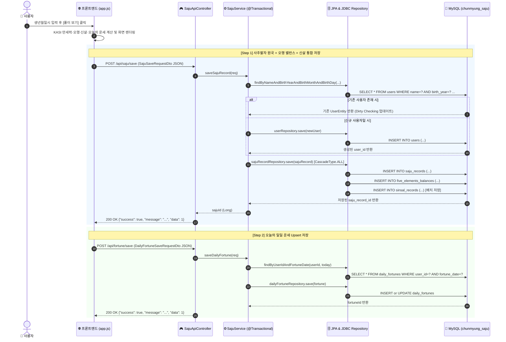
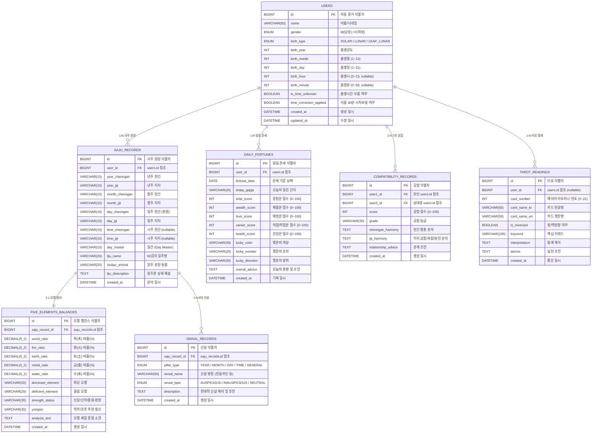

# 🌟 천명(天命) - 정통 사주 만세력 · 오늘의 운세 · 타로 풀스택 웹 서비스

> **한국천문연구원(KASI) 역법 데이터와 정통 명리학 기반 만세력 엔진 + Spring Boot 4.x & MySQL 8.x (JPA / JDBC) 백엔드 데이터베이스 연동 프로젝트**


---

## 📑 목차

1. [프로젝트 개요](#-1-프로젝트-개요)
2. [기술 스택 (Tech Stack)](#-2-기술-스택-tech-stack)
3. [핵심 구현 아키텍처 및 세부 구현 방법](#-3-핵심-구현-아키텍처-및-세부-구현-방법)
4. [요청-응답 처리 시퀀스 다이어그램](#-4-요청-응답-처리-시퀀스-다이어그램)
5. [데이터베이스 ERD 및 7대 정규화 엔티티 명세](#-5-데이터베이스-erd-및-7대-정규화-엔티티-명세)
6. [API별 상세 요청(Request) & 응답(Response) 명세](#-6-api별-상세-요청request--응답response-명세)
7. [프로젝트 디렉토리 구조](#-7-프로젝트-디렉토리-구조)
8. [IntelliJ IDEA & MySQL JDBC 연동 가이드](#-8-intellij-idea--mysql-jdbc-연동-가이드)
9. [로컬 빌드 및 실행 방법](#-9-로컬-빌드-및-실행-방법)

---

## 📖 1. 프로젝트 개요

**천명(天命)**은 사용자의 생년월일시(四柱)를 바탕으로 **사주팔자 4주 8자 원국, 오행(木·火·土·金·水) 에너지 밸런스, 신강/신약 및 용신(用神), 8대 신살, 오늘의 일진 운세, 2인 궁합, 3-Card 타로 점괘**를 분석하는 웹 애플리케이션입니다.

단순히 화면에 일회성으로 결과를 출력하거나 파일에 저장하는 방식에서 벗어나, **Spring Boot 프레임워크와 MySQL 데이터베이스를 JDBC 및 JPA로 연동**하여 도메인별 데이터를 **7개의 정규화된 엔티티 테이블**로 세분화해 영구 저장·조회하도록 구현했습니다.

---

## 🛠 2. 기술 스택 (Tech Stack)

| 영역 | 기술 / 라이브러리 | 버전 | 적용 및 구현 역할 |
| :---: | :--- | :---: | :--- |
| **Language** | Java (OpenJDK) | `21 LTS` | 백엔드 핵심 비즈니스 로직, 엔티티, DTO, 레포지토리 구현 |
| **Framework** | Spring Boot | `4.1.2` | 내장 Tomcat 웹 서버(`8085`), DI/IoC 컨테이너, REST API 구성 |
| **Database** | MySQL | `8.x` | `utf8mb4` 인코딩 기반 7대 정규화 사주/운세 테이블 영구 저장 |
| **ORM / JPA** | Spring Data JPA (Hibernate) | `7.4.x` | 엔티티 매핑, `@OneToOne`/`@OneToMany` 영속성 전이(`Cascade`), 더티 체킹 |
| **JDBC** | Spring JDBC (`JdbcTemplate`) | `7.0.x` | `DataSource` 커넥션 메타데이터 진단, 3중 JOIN 조회 및 집계 SQL 직접 실행 |
| **DB Pool** | HikariCP | `7.0.x` | 데이터베이스 커넥션 풀링 (`maximum-pool-size: 10`, `minimum-idle: 5`) |
| **API Docs** | SpringDoc OpenAPI (Swagger) | `3.2.0` | `/swagger-ui.html` 기반 REST API 명세 시각화 및 테스트 도구 제공 |
| **Frontend** | HTML5 / Tailwind CSS / ES6+ | `Standard` | KASI 24절기 만세력 계산 엔진, 12지신 수호동물 UI, `fetch` 비동기 API 통신 |
| **Build Tool** | Apache Maven (`mvnw`) | `3.9+` | 프로젝트 빌드, 의존성 관리 및 Lombok 애노테이션 프로세싱 |

---

## 🏗 3. 핵심 구현 아키텍처 및 세부 구현 방법

### 3-1. 계층형 아키텍처 (Layered Architecture)

```mermaid
flowchart LR
    subgraph Client ["🌐 프론트엔드 (Browser)"]
        UI["index.html / style.css"]
        Engine["만세력·운세 엔진<br/>(calendar.js, saju.js, fortune.js)"]
        ControllerJS["API 연동 컨트롤러<br/>(app.js - fetch API)"]
        UI --> Engine --> ControllerJS
    end

    subgraph SpringBoot ["🍃 Spring Boot 백엔드 (Port: 8085)"]
        API["SajuApiController<br/>(@RestController)"]
        SVC["SajuService<br/>(@Service, @Transactional)"]
        JPA["JPA Repositories<br/>(User, Saju, Fortune, Compat, Tarot)"]
        JDBC["SajuJdbcRepository<br/>(JdbcTemplate / DataSource)"]
        API --> SVC
        SVC --> JPA
        SVC --> JDBC
    end

    subgraph Database ["🐬 MySQL 8.x (chunmyung_saju)"]
        T1[("users")]
        T2[("saju_records")]
        T3[("five_elements_balances")]
        T4[("sinsal_records")]
        T5[("daily_fortunes")]
        T6[("compatibility_records")]
        T7[("tarot_readings")]
    end

    ControllerJS -- "HTTP JSON 요청<br/>(POST / GET)" --> API
    API -- "ApiResponseDto<T><br/>JSON 응답" --> ControllerJS
    JPA -- "Hibernate SQL" --> Database
    JDBC -- "Direct SQL JOIN" --> Database
```



### 3-2. 계층별 세부 구현 내용

| 계층 (Layer) | 구현 클래스 | 세부 구현 방법 및 핵심 로직 |
| :---: | :--- | :--- |
| **1. 프론트엔드 연산 및 비동기 전송** | `app.js`<br/>`saju.js`<br/>`fortune.js` | • 사용자가 생년월일시를 입력하면 KASI 24절기 데이터와 율리우스 적일(JDN) 알고리즘으로 사주 4주 8자·오행·신살·운세를 즉시 계산합니다.<br/>• 화면 렌더링 직후 `App.saveToDatabase()`가 호출되어 계산된 결과 객체를 백엔드 DTO 규격의 JSON으로 직렬화한 뒤 `fetch("/api/saju/save")`, `fetch("/api/fortune/save")`, `fetch("/api/compatibility/save")`로 비동기 전송합니다. |
| **2. 프레젠테이션 계층 (Controller)** | `SajuApiController` | • `@RestController`와 `@RequestMapping("/api")`를 통해 모든 REST 엔드포인트를 제공합니다.<br/>• 클라이언트로부터 전달받은 JSON 바디를 `@RequestBody` DTO로 역직렬화하고, 처리 결과를 공통 응답 래퍼인 `ApiResponseDto<T>`(`success`, `message`, `data`) 규격으로 일관되게 반환합니다. |
| **3. 비즈니스/트랜잭션 계층 (Service)** | `SajuService` | • 클래스 레벨에 `@Transactional(readOnly = true)`를 선언하고, 쓰기 메서드에 `@Transactional`을 부여해 트랜잭션 원자성을 보장합니다.<br/>• **사용자 Upsert 로직 (`findOrCreateUser`)**: `이름 + 생년 + 생월 + 생일`로 기존 회원을 조회하여, 이미 존재하면 성별·출생시각·보정 여부를 더티 체킹(Dirty Checking)으로 갱신하고, 없으면 신규 `UserEntity`를 INSERT합니다.<br/>• **연관 엔티티 일괄 저장 (`saveSajuRecord`)**: `SajuRecordEntity`를 생성하면서 `FiveElementsEntity`(1:1)와 `List<SinsalEntity>`(1:N)의 양방향 참조를 연결한 뒤 `CascadeType.ALL`을 통해 단 한 번의 `sajuRecordRepository.save()`로 3개 테이블에 동시 저장합니다. |
| **4. 영속성 계층 (JPA & JDBC 이원화)** | `UserRepository` 외 4종<br/>`SajuJdbcRepository` | • **Spring Data JPA**: 엔티티 단위의 CRUD와 메서드 이름 기반 쿼리(`findByNameAndBirthYear...`, `findByUserIdAndFortuneDate`)로 객체지향적인 데이터 저장을 담당합니다.<br/>• **Spring JDBC (`JdbcTemplate`)**: `DataSource.getConnection()`을 통한 실제 MySQL JDBC 드라이버 메타데이터 검증(`checkJdbcConnection`)과, `users` + `saju_records` + `five_elements_balances` 3개 테이블을 `INNER/LEFT JOIN`하여 최근 분석 내역을 한 번에 가져오는 고성능 조회 쿼리(`findRecentSajuHistory`)를 담당합니다. |

---

## 🔄 4. 요청-응답 처리 시퀀스 다이어그램

사용자가 웹 화면에서 **[사주 & 운세 풀이 보기]** 버튼을 클릭했을 때 프론트엔드, 스프링부트 백엔드, MySQL 데이터베이스 간에 일어나는 실제 요청·응답 흐름입니다.



---

## 🗄 5. 데이터베이스 ERD 및 7대 정규화 엔티티 명세

### 5-1. MySQL 데이터베이스 ERD (`chunmyung_saju`)



### 5-2. 7대 엔티티 클래스 및 테이블 매핑 요약

| 번호 | 엔티티 클래스 (`com.chunmyung.saju.entity`) | DB 테이블명 | 연관관계 어노테이션 | 핵심 역할 |
| :---: | :--- | :--- | :--- | :--- |
| **1** | `UserEntity.java` | `users` | `@Id @GeneratedValue` | 사용자 기본 인적사항 및 출생 역법·시차보정 설정 보관 |
| **2** | `SajuRecordEntity.java` | `saju_records` | `@ManyToOne(UserEntity)`<br/>`@OneToOne(FiveElements)`<br/>`@OneToMany(SinsalEntity)` | 사주 4주 8자(년·월·일·시 천간/지지), 본원 일간, 60갑자 일주론 해설 보관 |
| **3** | `FiveElementsEntity.java` | `five_elements_balances` | `@OneToOne(SajuRecordEntity)` | 목·화·토·금·수 5오행 비율(%), 최강/결핍 오행, 신강약, 추천 용신 보관 |
| **4** | `SinsalEntity.java` | `sinsal_records` | `@ManyToOne(SajuRecordEntity)` | 기둥별 작용하는 길신/흉신(천을귀인, 도화살, 역마살 등) 목록 및 해석 보관 |
| **5** | `DailyFortuneEntity.java` | `daily_fortunes` | `@ManyToOne(UserEntity)` | 날짜별 일진 간지와 5대 운세 점수(종합·재물·애정·직업·건강), 행운 아이템 보관 |
| **6** | `CompatibilityEntity.java` | `compatibility_records` | `@ManyToOne(user1, user2)` | 두 사용자 간의 궁합 점수, 등급, 천간 합충 및 지지 합충 분석 결과 보관 |
| **7** | `TarotEntity.java` | `tarot_readings` | `@ManyToOne(UserEntity)` | 22장 메이저 아르카나 카드 번호, 정/역방향, 키워드 및 리딩 결과 보관 |

---

## 📡 6. API별 상세 요청(Request) & 응답(Response) 명세

모든 REST API 응답은 아래 `ApiResponseDto<T>` 공통 포맷으로 반환됩니다.

| 응답 필드명 | 데이터 타입 | 설명 |
| :---: | :---: | :--- |
| `success` | `boolean` | 요청 처리 성공 여부 (`true` / `false`) |
| `message` | `String` | 처리 결과 안내 메시지 |
| `data` | `T` (Generic) | 실제 반환 데이터 (저장된 PK ID, 조회 리스트, 상태값 등) |

---

### ① JDBC 데이터베이스 연결 상태 진단 API

| 항목 | 상세 내용 |
| :---: | :--- |
| **HTTP Method & URI** | `GET /api/jdbc/check` |
| **담당 메서드** | `SajuApiController.checkJdbc()` ➔ `SajuJdbcRepository.checkJdbcConnection()` |
| **구현 동작** | `DataSource.getConnection()`으로 커넥션을 획득하여 MySQL JDBC 드라이버명, 접속 URL, DB 엔진 메타데이터를 검증합니다. |

#### 📥 요청 (Request)
```http
GET /api/jdbc/check HTTP/1.1
Host: localhost:8085
Accept: application/json
```

#### 📤 응답 (Response - 200 OK)
```json
{
  "success": true,
  "message": "MySQL JDBC 연결이 정상입니다.",
  "data": true
}
```

#### 📤 응답 (Response - 500 Internal Server Error, DB 연결 실패 시)
```json
{
  "success": false,
  "message": "MySQL JDBC 연결에 실패했습니다.",
  "data": null
}
```

---

### ② 사주팔자 4주 8자 · 오행 · 신살 통합 저장 API

| 항목 | 상세 내용 |
| :---: | :--- |
| **HTTP Method & URI** | `POST /api/saju/save` |
| **Content-Type** | `application/json` |
| **요청 DTO** | `SajuSaveRequestDto` |
| **구현 동작** | 1) `users` 테이블에 사용자 조회 또는 신규 등록(Upsert)<br/>2) `saju_records` 테이블에 4주 8자 및 일주론 저장<br/>3) `five_elements_balances` 테이블에 5오행 비율·신강약·용신 저장<br/>4) `sinsal_records` 테이블에 기둥별 신살 리스트 일괄 저장 |

#### 📋 Request Body 필드 명세

| 구분 | 필드명 | 타입 | 필수 | 설명 |
| :---: | :--- | :---: | :---: | :--- |
| **사용자** | `name` | `String` | Y | 사용자 이름 또는 닉네임 |
| **사용자** | `gender` | `String` | Y | 성별 (`"M"` 또는 `"F"`) |
| **사용자** | `birthType` | `String` | Y | 역법 구분 (`"SOLAR"`, `"LUNAR"`, `"LEAP_LUNAR"`) |
| **사용자** | `birthYear`, `birthMonth`, `birthDay` | `Integer` | Y | 출생 연·월·일 |
| **사용자** | `birthHour`, `birthMinute` | `Integer` | N | 출생 시·분 (시간 모름일 경우 `null`) |
| **사용자** | `isTimeUnknown` | `Boolean` | Y | 출생시간 모름 여부 (`true` / `false`) |
| **사용자** | `timeCorrectionApplied` | `Boolean` | Y | 서울 동경 127.5° 기준 30분 시차 보정 적용 여부 |
| **사주원장** | `yearCheongan`, `yearJiji` | `String` | Y | 년주(年柱) 천간·지지 (예: `"乙"`, `"亥"`) |
| **사주원장** | `monthCheongan`, `monthJiji` | `String` | Y | 월주(月柱) 천간·지지 (예: `"辛"`, `"巳"`) |
| **사주원장** | `dayCheongan`, `dayJiji` | `String` | Y | 일주(日柱) 천간·지지 (예: `"丙"`, `"寅"`) |
| **사주원장** | `timeCheongan`, `timeJiji` | `String` | N | 시주(時柱) 천간·지지 (예: `"乙"`, `"未"`) |
| **사주원장** | `dayMaster`, `iljuName`, `zodiacAnimal` | `String` | Y | 본원 일간(`"丙"`), 일주명(`"병인(丙寅)"`), 상징 동물(`"붉은 호랑이"`) |
| **오행밸런스** | `woodRatio` ~ `waterRatio` | `BigDecimal` | Y | 목·화·토·금·수 오행 비율 (`0.00` ~ `100.00`) |
| **오행밸런스** | `dominantElement`, `deficientElement` | `String` | Y | 가장 강한 오행 / 가장 부족한 오행 |
| **오행밸런스** | `strengthStatus`, `yongsin` | `String` | Y | 신강/신약 판정(`"신강(身强)"`) 및 추천 용신(`"금(金) / 수(水)"`) |
| **신살목록** | `sinsals[].pillarType`, `sinsalName`, `sinsalType`, `description` | `List<SinsalDto>` | N | 기둥 위치(`"YEAR"`, `"DAY"` 등), 신살명, 길흉 타입, 상세 해설 배열 |

#### 📥 요청 예시 (Request Body JSON)
```json
{
  "name": "홍길동",
  "gender": "M",
  "birthType": "SOLAR",
  "birthYear": 1995,
  "birthMonth": 5,
  "birthDay": 15,
  "birthHour": 14,
  "birthMinute": 30,
  "isTimeUnknown": false,
  "timeCorrectionApplied": true,
  "yearCheongan": "乙",
  "yearJiji": "亥",
  "monthCheongan": "辛",
  "monthJiji": "巳",
  "dayCheongan": "丙",
  "dayJiji": "寅",
  "timeCheongan": "乙",
  "timeJiji": "未",
  "dayMaster": "丙",
  "iljuName": "병인(丙寅)",
  "zodiacAnimal": "붉은 호랑이",
  "iljuDescription": "병인일주는 태양과 같은 열정과 진취적인 기상을 가집니다.",
  "woodRatio": 35.00,
  "fireRatio": 40.00,
  "earthRatio": 10.00,
  "metalRatio": 10.00,
  "waterRatio": 5.00,
  "dominantElement": "화(火)",
  "deficientElement": "수(水)",
  "strengthStatus": "신강(身强)",
  "yongsin": "금(金) / 수(水)",
  "analysisText": "화(火)와 목(木)의 기운이 왕성하여 추진력과 리더십이 뛰어납니다.",
  "sinsals": [
    {
      "pillarType": "DAY",
      "sinsalName": "홍염살",
      "sinsalType": "NEUTRAL",
      "description": "사람을 끄는 다정한 매력과 예술적 감각이 돋보입니다."
    },
    {
      "pillarType": "YEAR",
      "sinsalName": "천을귀인",
      "sinsalType": "AUSPICIOUS",
      "description": "위기 상황에서 뜻밖의 조력자를 만나는 최고의 길신입니다."
    }
  ]
}
```

#### 📤 응답 예시 (Response - 200 OK)
```json
{
  "success": true,
  "message": "사주 분석 결과가 MySQL 데이터베이스에 성공적으로 저장되었습니다. (ID: 1)",
  "data": 1
}
```

---

### ③ 오늘의 일일 운세 저장 API

| 항목 | 상세 내용 |
| :---: | :--- |
| **HTTP Method & URI** | `POST /api/fortune/save` |
| **Content-Type** | `application/json` |
| **요청 DTO** | `DailyFortuneSaveRequestDto` |
| **구현 동작** | 사용자 정보를 확인한 후, `user_id`와 `fortune_date`(오늘 날짜)로 `daily_fortunes` 테이블을 조회하여 기존 기록이 있으면 점수와 조언을 업데이트(Update)하고, 없으면 새로 삽입(Insert)합니다. |

#### 📥 요청 예시 (Request Body JSON)
```json
{
  "name": "홍길동",
  "gender": "M",
  "birthYear": 1995,
  "birthMonth": 5,
  "birthDay": 15,
  "fortuneDate": "2026-11-20",
  "todayGapja": "무술(戊戌)",
  "totalScore": 88,
  "wealthScore": 85,
  "loveScore": 90,
  "careerScore": 92,
  "healthScore": 80,
  "luckyColor": "로열 골드",
  "luckyNumber": "3, 8",
  "luckyDirection": "남동쪽",
  "overallAdvice": "식신생재의 기운이 강하게 들어와 노력한 만큼 실질적인 성과와 재물이 따르는 길일입니다."
}
```

#### 📤 응답 예시 (Response - 200 OK)
```json
{
  "success": true,
  "message": "오늘의 운세가 MySQL 데이터베이스에 성공적으로 저장되었습니다.",
  "data": 1
}
```

---

### ④ 2인 사주 궁합 분석 결과 저장 API

| 항목 | 상세 내용 |
| :---: | :--- |
| **HTTP Method & URI** | `POST /api/compatibility/save` |
| **Content-Type** | `application/json` |
| **요청 DTO** | `CompatibilitySaveRequestDto` |
| **구현 동작** | 본인(`user1`)과 상대방(`user2`)을 각각 `users` 테이블에 Upsert 처리한 뒤, 두 사용자의 외래키(`user1_id`, `user2_id`)와 궁합 점수, 천간·지지 합충 분석 결과를 `compatibility_records` 테이블에 저장합니다. |

#### 📥 요청 예시 (Request Body JSON)
```json
{
  "user1Name": "홍길동",
  "user1Gender": "M",
  "user1BirthYear": 1995,
  "user1BirthMonth": 5,
  "user1BirthDay": 15,
  "user2Name": "성춘향",
  "user2Gender": "F",
  "user2BirthYear": 1997,
  "user2BirthMonth": 8,
  "user2BirthDay": 20,
  "score": 94,
  "grade": "천생연분",
  "cheonganHarmony": "병신합수(丙辛合水)로 서로의 부족한 오행을 채워주는 최상의 천간 배합입니다.",
  "jijiHarmony": "인오술(寅午戌) 삼합의 기운이 작용하여 가치관과 생활 리듬이 안정적으로 조화를 이룹니다.",
  "relationshipAdvice": "서로의 추진력과 세심함이 시너지를 내므로 장기적인 미래를 함께 설계하기에 매우 좋습니다."
}
```

#### 📤 응답 예시 (Response - 200 OK)
```json
{
  "success": true,
  "message": "궁합 분석 결과가 MySQL 데이터베이스에 성공적으로 저장되었습니다.",
  "data": 1
}
```

---

### ⑤ 타로 카드 점괘 결과 저장 API

| 항목 | 상세 내용 |
| :---: | :--- |
| **HTTP Method & URI** | `POST /api/tarot/save` |
| **Content-Type** | `application/json` |
| **요청 DTO** | `TarotSaveRequestDto` |
| **구현 동작** | 사용자가 선택한 메이저 아르카나 카드 번호(0~21), 한글/영문명, 정·역방향 여부, 키워드와 리딩 조언을 `tarot_readings` 테이블에 저장합니다. |

#### 📥 요청 예시 (Request Body JSON)
```json
{
  "userId": 1,
  "cardNumber": 19,
  "cardNameKr": "19. 태양",
  "cardNameEn": "The Sun",
  "isReversed": false,
  "keyword": "성공, 활력, 명쾌한 해결, 긍정적 결실",
  "interpretation": "어두웠던 고민이 걷히고 모든 상황이 투명하고 밝게 드러나는 시기입니다.",
  "advice": "망설이던 프로젝트나 고백이 있다면 자신감을 가지고 지금 실행에 옮기세요."
}
```

#### 📤 응답 예시 (Response - 200 OK)
```json
{
  "success": true,
  "message": "타로 카드 점괘가 MySQL 데이터베이스에 성공적으로 저장되었습니다.",
  "data": 1
}
```

---

### ⑥ 최근 사주 분석 이력 조회 API (Spring JDBC 3중 JOIN)

| 항목 | 상세 내용 |
| :---: | :--- |
| **HTTP Method & URI** | `GET /api/history/recent?limit=10` |
| **Query Parameter** | `limit` (기본값 `10`, 조회할 최근 건수) |
| **담당 메서드** | `SajuApiController.getRecentHistory()` ➔ `SajuJdbcRepository.findRecentSajuHistory(limit)` |
| **구현 동작** | `JdbcTemplate`을 사용하여 `saju_records`, `users`, `five_elements_balances` 3개 테이블을 직접 SQL `JOIN`하여 최신순으로 반환합니다. |

#### 📥 요청 (Request)
```http
GET /api/history/recent?limit=5 HTTP/1.1
Host: localhost:8085
Accept: application/json
```

#### 📤 응답 예시 (Response - 200 OK)
```json
{
  "success": true,
  "message": "최근 1건의 기록을 조회했습니다.",
  "data": [
    {
      "user_id": 1,
      "name": "홍길동",
      "gender": "M",
      "birth_year": 1995,
      "birth_month": 5,
      "birth_day": 15,
      "saju_id": 1,
      "year_cheongan": "乙",
      "year_jiji": "亥",
      "month_cheongan": "辛",
      "month_jiji": "巳",
      "day_cheongan": "丙",
      "day_jiji": "寅",
      "time_cheongan": "乙",
      "time_jiji": "未",
      "ilju_name": "병인(丙寅)",
      "zodiac_animal": "붉은 호랑이",
      "wood_ratio": 35.00,
      "fire_ratio": 40.00,
      "earth_ratio": 10.00,
      "metal_ratio": 10.00,
      "water_ratio": 5.00,
      "strength_status": "신강(身强)",
      "yongsin": "금(金) / 수(水)",
      "created_at": "2026-11-20T10:55:19"
    }
  ]
}
```

---

## 🗂 7. 프로젝트 디렉토리 구조

```text
Daily Fortune/
├── pom.xml
├── mvnw
├── mvnw.cmd
└── src/
    └── main/
        ├── java/com/chunmyung/saju/
        │   ├── SajuApplication.java
        │   ├── config/
        │   │   └── WebConfig.java
        │   ├── controller/
        │   │   └── SajuApiController.java
        │   ├── service/
        │   │   └── SajuService.java
        │   ├── repository/
        │   │   ├── SajuJdbcRepository.java
        │   │   ├── UserRepository.java
        │   │   ├── SajuRecordRepository.java
        │   │   ├── DailyFortuneRepository.java
        │   │   ├── CompatibilityRepository.java
        │   │   └── TarotRepository.java
        │   ├── entity/
        │   │   ├── UserEntity.java
        │   │   ├── SajuRecordEntity.java
        │   │   ├── FiveElementsEntity.java
        │   │   ├── SinsalEntity.java
        │   │   ├── DailyFortuneEntity.java
        │   │   ├── CompatibilityEntity.java
        │   │   └── TarotEntity.java
        │   └── dto/
        │       ├── ApiResponseDto.java
        │       ├── SajuSaveRequestDto.java
        │       ├── DailyFortuneSaveRequestDto.java
        │       ├── CompatibilitySaveRequestDto.java
        │       └── TarotSaveRequestDto.java
        └── resources/
            ├── application.yml
            ├── schema.sql
            └── static/
                ├── index.html
                ├── css/
                │   └── style.css
                └── js/
                    ├── app.js
                    ├── data/
                    │   ├── gapja60.js
                    │   ├── sinsal.js
                    │   └── tarot.js
                    └── engine/
                        ├── calendar.js
                        ├── saju.js
                        └── fortune.js
```

| 패키지 / 폴더 경로 | 주요 파일 | 설명 |
| :--- | :--- | :--- |
| `com.chunmyung.saju.controller` | `SajuApiController.java` | 클라이언트의 HTTP 요청을 받아 DTO로 매핑하고 JSON 응답을 반환하는 REST 컨트롤러 |
| `com.chunmyung.saju.service` | `SajuService.java` | `@Transactional` 기반 사용자 Upsert 및 7대 엔티티 영속화 비즈니스 로직 |
| `com.chunmyung.saju.repository` | `SajuJdbcRepository.java` 외 5종 | Spring JDBC(`JdbcTemplate`) 직접 쿼리 및 Spring Data JPA 인터페이스 |
| `com.chunmyung.saju.entity` | `UserEntity.java` 외 6종 | MySQL 7대 테이블과 1:1 매핑되는 JPA 엔티티 클래스 |
| `com.chunmyung.saju.dto` | `SajuSaveRequestDto.java` 외 4종 | 계층 간 데이터 교환을 위한 Request / Response DTO |
| `src/main/resources` | `application.yml`, `schema.sql` | MySQL DataSource/HikariCP 설정 및 데이터베이스 DDL 스크립트 |
| `src/main/resources/static` | `index.html`, `css/`, `js/` | KASI 만세력 연산 엔진, 반응형 UI, 백엔드 API 자동 연동 프론트엔드 리소스 |

---

## 💻 8. IntelliJ IDEA & MySQL JDBC 연동 가이드

| 단계 | 설정 위치 | 설정 값 및 실행 방법 |
| :---: | :--- | :--- |
| **Step 1** | **프로젝트 열기** | IntelliJ IDEA 실행 ➔ `Open` ➔ `Daily Fortune` 폴더 선택 ➔ `Load Maven Project` 클릭 |
| **Step 2** | **Java SDK 설정** | `File` ➔ `Project Structure` (`Cmd + ;`) ➔ **Project SDK: Java 21** 선택 |
| **Step 3** | **Database 탭 연결** | 우측 `Database` 탭 ➔ `+` ➔ `Data Source` ➔ **MySQL** 클릭 |
| **Step 4** | **JDBC 접속 정보** | • **Host**: `localhost` / **Port**: `3306`<br/>• **Database**: `chunmyung_saju`<br/>• **User**: `root` / **Password**: 로컬 MySQL 비밀번호 입력<br/>• **URL**: `jdbc:mysql://localhost:3306/chunmyung_saju` |
| **Step 5** | **커넥션 테스트** | `Test Connection` 클릭 ➔ `Succeeded` 확인 후 `OK` 클릭 |

---

## 🚀 9. 로컬 빌드 및 실행 방법

### 1. MySQL 스키마 초기화
```bash
mysql -u root -p -e "CREATE DATABASE IF NOT EXISTS chunmyung_saju CHARACTER SET utf8mb4 COLLATE utf8mb4_unicode_ci;"
mysql -u root -p chunmyung_saju < src/main/resources/schema.sql
```

### 2. Spring Boot 서버 구동
```bash
./mvnw spring-boot:run
```

### 3. 주요 접속 URL

| 서비스 항목 | 접속 주소 (URL) | 비고 |
| :--- | :--- | :--- |
| **사주 & 운세 메인 웹 화면** | `http://localhost:8085/` | 분석 시 MySQL 자동 저장 연동 |
| **Swagger OpenAPI 문서** | `http://localhost:8085/swagger-ui.html` | 전체 API 명세 조회 및 즉시 호출 테스트 |
| **JDBC 연결 진단 API** | `http://localhost:8085/api/jdbc/check` | MySQL JDBC 커넥션 상태 확인 |
| **최근 사주 기록 조회 API** | `http://localhost:8085/api/history/recent` | JDBC 3중 JOIN 쿼리 결과 JSON 확인 |
